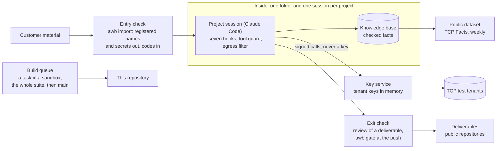

<h1 align="center">Architect Workbench</h1>

> **Unofficial and independent.** Not a product of, and not endorsed by, T-Systems or Deutsche Telekom; it speaks for nobody but its author. Built only from public sources (the public documentation, the public service description, the public price API), with respect for robots.txt and the terms of those sources. No customer data and no confidential information. No warranty: the provider's contract documents are binding.

<p align="center"><b>A harness for cloud architecture work on T Cloud Public (TCP)</b></p>

<p align="center">
  
  <a href="INSTALL.md"></a>
  <a href="COMMANDS.md"></a>
  <a href="https://github.com/shimoza/tcp-facts"></a>
  <a href="docs/install.md#as-a-plugin-for-claude-code"></a>
  <a href="LICENSE"></a>
</p>


## What it is and why

An AI assistant writes a fluent answer about a cloud platform whether or not it knows the platform. For architecture
work that is not good enough: a limit that changed last month, a price from memory or a customer name in a prompt
costs a customer's trust. The Workbench is a harness around the assistant (Claude Code) for work on T Cloud Public
(TCP). The model reasons and writes; the Workbench decides what it may use and checks what it hands out. Answers
come from checked facts with a source and a check date, prices come live from the public price API, arithmetic is
exact, a claim about behaviour is tested on a real test tenant and a text is reviewed before it leaves. A customer
appears only as a code (`CUST-Q7M4`). Most of it is not tied to one cloud; the facts, prices and API details are for
TCP.

## The design in one picture



- **Entry check.** Customer material enters a project only through one door (`awb import`). Registered names
  become codes, other names become tokens (`[person 1]`), secrets are taken out. The register of names lives in an
  encrypted vault that a session cannot read; a session only gets a yes or no from it.
- **Inside.** Every piece of work has its own folder with its goal, its rules and its git history. Seven hooks
  watch every prompt, every write, every file or shell call, the start and the end of a session and the compaction.
  A tool guard keeps a session inside its project and an egress filter refuses every host outside a short list.
  Inside a project the checks read no content: the checks stay at the entry and at the exit.
- **Key service.** The keys of the test tenants stay in the memory of a separate service. A session sends a call
  and gets it signed; it never holds a key.
- **Exit check.** A deliverable is reviewed (claims, evidence, house style) before it leaves. The commit gate
  (`awb gate`) refuses registered names, secrets, home paths and a local blocklist at the push of a public repository.
- **Build queue.** The Workbench builds itself: a task runs as a separate build user in a sandbox, the whole test
  suite runs on its commit and only a green commit reaches `main`.
- **Public dataset.** The checked facts leave every week as the open dataset
  [TCP Facts](https://github.com/shimoza/tcp-facts) (CC BY 4.0): a Markdown file for any assistant, JSON lines and
  an MCP server.

On the full setup two system users on one host hold the two sides apart. The person who runs the host (the owner in
the docs) keeps the register, the tenant keys and the originals; a separate work user runs every session. The
quick start below needs none of that. The full picture is in [docs/design.md](docs/design.md).

## What this proves

Each number can be checked with the command next to it, in a clone of this repository or of the dataset.
[STATS.json](STATS.json) holds the numbers of this repository, each with `counted_by`, the command that counts it
again: `python3 tools/stats.py` writes it (`--pytest` counts the tests by collection). The dataset carries the same
kind of file, STATS.json beside its facts.jsonl.

| what | number | check |
|---|---|---|
| tests, each with its status | 4,445, none failing | `jq '.total_tests' build/tests.json` and `jq '[.tests[] \| select(.status != "passing")] \| length' build/tests.json` |
| commits on `main` | 940 on 2026-11-27 | `gh api --paginate 'repos/shimoza/tcp-awb/commits?per_page=100' --jq length \| jq -s add` |
| facts in the public dataset, each with its source and check date | on the first screen of each weekly release | `jq -s 'map(select(.id)) \| length' facts.jsonl` in a clone of shimoza/tcp-facts |
| facts tested live on a TCP tenant | on the same first screen | `jq -s 'map(select(.grade == "live")) \| length' facts.jsonl` |
| lab recipes, one live check on a test tenant each | 12 | `jq -n '[inputs] \| length' recipes/*.json` |
| services of the service description, each offered or not | 79 (revision of 18.11.2026) | `awb service list \| head -1` |
| hooks a session runs | 7 | `jq '[.hooks[][].hooks[]] \| length' plugin/hooks/hooks.json` |
| weekly releases of the dataset | one every Monday | `gh release list --repo shimoza/tcp-facts --limit 1000 --json tagName --jq length` |

The rest of the numbers of STATS.json of 2026-11-27, with the command that recomputes each (`jq -r 'to_entries[] | select(.value | type == "object") | "\(.key): \(.value.counted_by)"' STATS.json` lists them all):

- lines of Python in `awb/`, 124,411: `git ls-files -z -- 'awb/*.py' | xargs -0 cat | wc -l`
- modules in `awb/`, 199: `git ls-files -- 'awb/*.py' | grep -v '/__init__.py$' | wc -l`
- test functions, 6,278: `git grep -hE '^[[:space:]]*(async[[:space:]]+)?def test_' -- 'tests/*.py' | wc -l`; `python3 tools/stats.py --pytest` counts by collection
- commands in the reference, 274: ``sed -n '/^## Reference of every command and option/,$p' COMMANDS.md | grep -c '^### `awb '``
- skills of the plugin, 7: `git ls-files -- 'plugin/skills/*/SKILL.md' | wc -l`
- agents of the plugin, 2: `git ls-files -- 'plugin/agents/*.md' | wc -l`
- commits since 2026-09-28, 944: `git rev-list --count --since=2026-09-28 HEAD`
- build tasks done and branch checks passed and refused: `awb build list`, on the owner's host only, so not in the file of a clone

## Built with Claude Code

The code of the Workbench is written by AI coding agents: Claude Code, and Codex for the web interface until
2026-11-19. They work under the design, review and acceptance of the author.

The author does these himself: the architecture, the rules the agents follow, the red teams of his own designs, the
acceptance tests and every merge decision. An agent never merges its own work.

A change is judged by the build queue ([docs/build-queue.md](docs/build-queue.md)). Its checks run without a model:
the tests, the commit gate, the list of paths the task may touch and a check that no test was edited, skipped or
hollowed out to make it pass. A change that fails one of them goes back.

A commit carries the author as the person responsible for it, whoever or whatever wrote the lines. A commit message
may name the agent or the review a change came from.

## Quick start

No sealed host, no vault, no key service and no model needed. Python 3.12 or later and `git`; `gh` to fetch the facts.

```bash
git clone https://github.com/shimoza/tcp-awb.git && cd tcp-awb
python3 -m venv .venv && .venv/bin/pip install -e .
. .venv/bin/activate

gh repo clone shimoza/tcp-facts -- --depth 1    # the public facts
awb kb import tcp-facts/facts.jsonl             # a knowledge base in ~/tcp-kb, every fact checked as it goes in

awb kb find object storage lifecycle            # the first 20 matching facts, each with its grade and check date
awb calc "3 * 0.0218 * 730" --dry               # exact decimals: 47.742
awb service check "Object Storage Service"      # offered or not, with the section of the service description
```

To run the tests as well: `.venv/bin/pip install -e '.[test]' && .venv/bin/pytest`. The tests use invented names
only and a throw-away Workbench each. The laptop edition, the anonymization on a laptop and the plugin for Claude Code
are in [docs/install.md](docs/install.md); the sealed host is in [INSTALL.md](INSTALL.md).

## A few commands

One line each; the docs page next to it has the details and [COMMANDS.md](COMMANDS.md) has every option.

| command | what it does | more |
|---|---|---|
| `awb start project --goal "..." --customer new` | a new piece of work in one command: code, forms, folder and import | [owner guide](docs/owner-guide.md) |
| `awb import CODE --trusted DIR` | customer material into a project through the entry check | [customer data](docs/dmz.md) |
| `awb price find ecs --grep s3.large` | live prices with every term | [architect guide](docs/architect-guide.md) |
| `awb price pool ecs --flavor F --os Windows --hours 2720 --term R24` | Reserved for many machines; a workbook line with `mode: pool` does the same | [architect guide](docs/architect-guide.md) |
| `awb pricebook build estimate.txt --lang de` | a price workbook (.xlsx) from a specification, priced live; `awb pricebook diff OLD NEW` compares versions | [architect guide](docs/architect-guide.md) |
| `awb lab run ecs-boot-ssh --project CODE --tenant NAME` | a live check on a test tenant: raise, check, evidence, always torn down | [tenants](docs/tenants.md) |
| `awb review init`, `claims`, `l0`, `pass` | the review of a deliverable before it leaves | [architect guide](docs/architect-guide.md) |
| `awb side start NAME --brief FILE` | side work (a report, research) in a headless session of its own | [architect guide](docs/architect-guide.md) |
| `awb dataset build` | the dataset TCP Facts from the knowledge base | [dataset](docs/dataset.md) |
| `awb career feed` | the weekly evidence file for a CV: one record per piece of work, each number with the command that counts it, codes and names never in it | [commands](COMMANDS.md) |
| `awb gate --selftest` | the commit gate checks itself | [customer data](docs/dmz.md) |

## Documentation

- [docs/design.md](docs/design.md): the parts, the folders of this repository and the personal parts
- [docs/dmz.md](docs/dmz.md): customer data at the entry, inside a project and at the exit
- [docs/architect-guide.md](docs/architect-guide.md): what it does for an architect, the main commands, PDF and Word
- [docs/tenants.md](docs/tenants.md): test tenants, the key service, lab runs and Windows lab machines
- [docs/exchange.md](docs/exchange.md): files in and out of a project
- [docs/console.md](docs/console.md): the board, the console and the console how-tos
- [docs/dataset.md](docs/dataset.md): the knowledge as the dataset TCP Facts, its signing and its MCP server
- [docs/install.md](docs/install.md): install, the test suite, the laptop edition and the plugin
- [docs/owner-guide.md](docs/owner-guide.md): the daily work of the owner, requests, frictions and the hand-over
- [docs/operations.md](docs/operations.md): the recovery pack, the deploy and the sealed setup
- [docs/build-queue.md](docs/build-queue.md): how the Workbench builds itself
- [INSTALL.md](INSTALL.md): the sealed host, step by step
- [COMMANDS.md](COMMANDS.md): every command and option, generated from the code
- [INTERFACES.md](INTERFACES.md): the interface of every module
- [recipes/README.md](recipes/README.md): the format of the lab recipes
- [plugin/README.md](plugin/README.md): the Claude Code plugin
- [CHANGELOG.md](CHANGELOG.md): what changed, one entry per week

## License

The Workbench is licensed under the Apache License 2.0. The text is in [LICENSE](LICENSE), the copyright in
[NOTICE](NOTICE). The facts of TCP Facts are CC BY 4.0.
