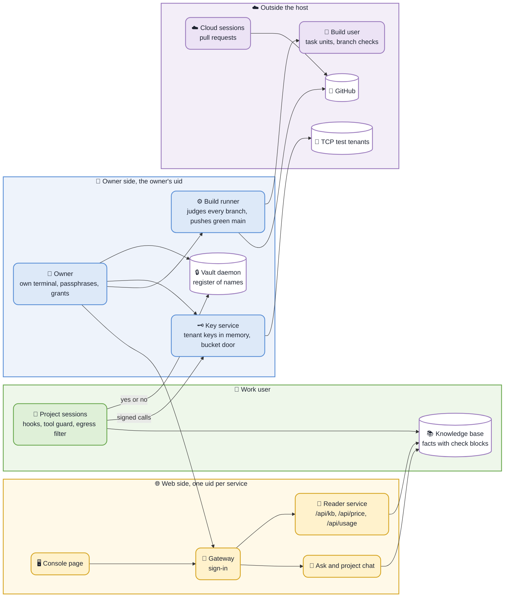

<h1 align="center">Architect Workbench</h1>

> **Unofficial and independent.** Not a product of, and not endorsed by, T-Systems or Deutsche Telekom; it speaks for nobody but its author. Built only from public sources (the public documentation, the public service description, the public price API), with respect for robots.txt and the terms of those sources. No customer data and no confidential information. No warranty: the provider's contract documents are binding.

<p align="center"><b>A harness for cloud architecture work on T Cloud Public (TCP)</b></p>

<p align="center">
  
  <a href="INSTALL.md"></a>
  <a href="COMMANDS.md"></a>
  <a href="https://github.com/shimoza/tcp-facts"></a>
  <a href="#as-a-plugin-for-claude-code"></a>
  <a href="LICENSE"></a>
</p>

```bash
$ awb start project --goal "Test a virtual firewall appliance on TCP" --customer new
```

To run the Workbench on your own Linux host, follow [INSTALL.md](INSTALL.md).

The Workbench sits around an AI assistant (Claude
Code). The model reasons and writes. The Workbench decides what the model may use, checks what it hands out and
keeps the record: checked facts in place of the model's memory, live prices, exact arithmetic, real test tenants and
a review before any text leaves.

You work in it as with a colleague in a terminal. You ask in plain words. The session looks the facts up, asks the
price API, builds on a test tenant when the work needs it and writes down what it found with a source for each
statement. A customer or partner appears only as a code (`CUST-Q7M4`), a piece of work as a project code
(`tcp-q7m4`).

Most of it is not tied to one cloud. The facts, prices and API details are for TCP.

## The parts

Two users on one host hold the two sides apart. The owner keeps the register of names (the vault), the tenant
keys (the key service) and the originals. The work user runs every session and owns the projects. A session gets a
yes or no from the vault and a signed call from the key service, never a name and never a key.

| part | what it is |
|---|---|
| the vault daemon | the register of codes and names, encrypted at rest; a session asks it whether a text carries a name and gets a yes or no |
| the key service | holds the keys and secrets of the test tenants in memory and signs the calls a session sends; since week 42 it is also the owner's one door to the bucket (`awb bucket`, `awb import`, `awb fetch`, `awb dataset put`), so no bucket key lives in the environment |
| the project sessions | Claude Code as the work user, one folder per project, six hooks, a tool guard, an egress filter that refuses every host outside the list |
| the knowledge base | checked facts with a grade and an expiry; the fact-check service checks an expired fact again on a test tenant (a check block per fact, a weekly read run, a monthly write run, a watchdog) |
| the console | the web side behind a sign-in: the projects, the board, the tenants, the project chat and Ask; its page reads the knowledge base, the price lookup and the usage from the reader service (`/api/kb`, `/api/price`, `/api/usage`); the old read-only portal is gone |
| the build runner and `awb pr take` | the Workbench builds itself: a task runs as the build user in sandboxed units, a pull request of a cloud session is checked in the same sandbox and taken in with one command, `sudo awb deploy` brings a release live |



## Start here (the owner)

```bash
awb unlock                                   # after a reboot: the vault, then the keys, each asks its passphrase
awb                                          # which side you are on, what is locked, the first item that waits on you
awb start project --goal "..." --customer new   # a new piece of work: code, forms, spawn, grant and import in one command
awb start project --goal "..." --customer new --from DIR --trusted   # the same, the import takes every file of DIR and its subfolders; ends with the app line
awb projects open                            # the active projects numbered with their Next line; the number opens one
awb fetch tcp-xxxx                           # what a project put for you, downloaded with the names back
```

## Two kinds of work

Every piece of work starts with `awb spawn` (or `awb start` on the owner side, which wraps it) and gets its own
folder with its goal, its rules, its checkpoints and
its git history. The review tier of the project is set once: `--review-tier 1|2|3` of `awb start` and `awb spawn`
(default 3) writes `- review-tier:` into its SCOPE.md, a deliverable takes it unless you raise it for that file, and
`awb projects tier tcp-xxxx 2` changes it later, as the owner. The send gate keeps refusing below the tier.

| kind | for | reaches |
|---|---|---|
| query | a question: can TCP do this, what does it cost, how does a service behave | the knowledge base, the documentation, the service description, live prices, `awb calc` |
| project | a proof of concept, a lab, a migration plan | everything a query reaches, plus the test tenants |

A query that turns out to need a live test becomes a project with `awb projects kind tcp-xxxx project`. A query
never touches a tenant: the key service refuses its calls. A session's switch changes its row only; the key service
also wants the owner's grant, which the same command writes when the owner runs it in his own terminal. The grant
also records the customer of the project's row at that moment (a CUST code or none). From then on the key service
takes the customer for an owner-inbox take, a take from the project's folder, the send gate of a put and the
lease from the grant alone: a row that names another customer is refused in one line with the project code. A
project granted before 2026-10-10 gets its customer into the grant when the owner runs `awb projects kind` for it
once more; `awb projects check`, run by the owner, lists those and every row that differs from its grant. A
project the owner never granted has no customer for the key service, whatever its row says: its owner-inbox take
holds, its take from its own folder runs under the project code and its put meets the strict send gate. So the owner
runs `awb projects kind CODE query` once for a customer project before its first take from the owner inbox.

## Live tenants through the key service

A project builds and checks on real TCP test tenants. The session never holds a key. The key service runs on
the owner's side. It keeps the keys, logins and passwords of every test tenant in memory and signs each call a
session sends: a call to OBS the OBS way, every other service the way of the API gateway. The read key allows
reads only. A write needs the lab key and the code of an active project. A write to the identity service is
always refused. Every answer comes back with every key and secret taken out.

A session's call and lease are bound to its own project by a key token, never by the code the request names (K4 of
the review of 2026-10-20). `awb spawn` writes the token into the project folder (`.git/awb-key-token`, mode 640, never
tracked by git); the owner's grant (`awb projects kind CODE project`) records it in `<vault>/key-tokens.json` (mode 600). The
awb client sends the token of the folder it works in with each call and lease. The key service takes the session's
project from it: a request that names another project or comes with no token or a wrong one is refused before
anything is signed. The service reads only the request and the owner's files, never the caller's process, so it works
with the service as the owner and the sessions as the work user. The owner's own calls carry no binding. A project
spawned before the token gets one with its first `awb cloud` call; the key service then refuses with `the grant of
CODE holds no key token` until the owner runs `awb projects kind CODE project` once more. The sessions of other
projects share the work user, so the token is kept from them by the place guard, as the rest of the folder is.

Every resource a project creates carries the project code as a tag and a row in the project's `RESOURCES.md`. A
daily snapshot tells what ran on which tenant on which day. `awb close` refuses while something is still running.
What a session learned live on the platform goes into the knowledge base with the grade `live`.

The most frequent live check (raise a few resources, check one thing, tear down) is a lab recipe: `awb lab run
ecs-boot-ssh --project tcp-q7m4 --tenant test-1` does it in one command (inside the project's folder both flags are optional: the code comes from SCOPE.md and the tenant from its `tenant:` line, which `awb spawn --tenant test-1` writes). The recipe (a JSON file under `recipes/`)
names the question, the calls, the checks, the teardown, a time budget and a cost guard. The run tags every resource
and writes its row in `RESOURCES.md` before the create call. When the answer of a create is lost it looks the
resource up by its name and records it or proves it not created. It always tears down, also on a failed check, an
error, the time budget or Ctrl-C, proves each resource gone and writes the evidence with a ready `awb kb add` line.
A recipe that fills a password from a tenant secret asks the key service for the names of the tenant's secrets
first and stops before any create when one is missing. A refused call keeps its error code and the start of its
error message in the evidence. A create whose refusal a check expects (the 500 of an RDS collation it does not take)
goes on when the find proves nothing was made; the recipes `ecs-flavor-boot`, `smn-http-confirm` and
`rds-create-refusal` are the write-tier checks of the fact-check service. A recipe may read before its first create
(`preflight`): `rds-create-refusal` reads the RDS storage types and stops with one line unless its `volume_type`
(default CLOUDSSD) is normal in the AZ. A create step may name a `shape_error`: a 400 with an error code DBS.28xxxx
stops the run as a recipe error and is never taken as the answer a check looks for.
Five more recipes (`eip-bandwidth-adjust`, `evs-snapshot-restore`, `nat-snat-egress`, `obs-lifecycle-rule` and
`dns-private-zone`) are tested on fake answers only; `recipes/README.md` lists the shapes still to confirm live.
`awb lab list` shows the recipes and `awb lab dry-run` the calls a run would make. A resource it cannot delete stays
in `RESOURCES.md` as live with the line to delete it.

## Public documentation through the key service

A session cannot reach a documentation host: the egress filter of the work user lets it reach the model API, the
client's hosts and the public price API only, and opening it to the hosts of `rules/allow-domains.txt` would give a
session a way to send data out. So the key service, which runs as the owner and has internet, reads the page for it.
`awb doc fetch URL [--out FILE]` sends the op `doc_get` on the call socket and prints the text with the first line
`source: URL, fetched YYYY-MM-DD HH:MM UTC` (or writes it to FILE inside the project folder). The service fetches by
GET only, https only, the host exactly a line of `rules/allow-domains.txt` (`awb doc hosts` lists them), no port, no
user info, no query string, no fragment and a path of at most 300 URL-safe characters. It follows at most 3
redirects and only to a URL that passes the same checks, takes at most 5 MB and only HTML, Markdown, plain text or
JSON, and turns HTML into text (headings, paragraphs, lists, code, tables). It sends no cookie and no auth header, and
its User-Agent names the Workbench. A project gets at most 30 fetches a minute and 500 a day. Each fetch writes one
line to `<vault>/log/doc-YYYY-MM.tsv`: time, project, host, path, size and status, never page content. The work rules
say to quote such a page with its source and date and never to state it from memory when it can be fetched. A host
off the list is refused with one line that tells the session to leave one owner item in OPEN.md under the owner
heading, `Steering: allow documentation host HOST (vendor, why)`, instead of asking. `rules/allow-domains.txt` now
also lists the official documentation hosts of Red Hat, Ubuntu, Cisco, Broadcom, VMware, NVIDIA and TCP
(`docs.otc.t-systems.com`, `docs-beta.otc.t-systems.com`); no forum, blog or Q&A site.

## The exchange: files in and out

Files come in through two inboxes in object storage (OBS). You drop a file there and tell the session in your own
words which one you mean ("the pdf", "the newest", a part of its name). The session takes it with `awb inbox take`.

| inbox | for | what the session gets |
|---|---|---|
| the lab inbox | material without customer content: vendor images, test data, public documents | the file itself, after the name check |
| the owner inbox | anything that may hold customer material | only the sanitised copies of the owner's intake, never the original |

Every project also has its own folder `<YYYY-MM>/<code>/in/` in the owner bucket. `awb spawn` makes it through
the key service. The console puts files there, each of at most 25 MiB and of a kind the console reads; the key
service moves at most `max_mb` of keys.conf (default 100) in one object. `awb/bucket_layout.py` sets the folders, the
kinds and both limits for every side. Each project folder holds a small file `.keep` in `in/` and `out/` (one line of text) so
that S3 clients which cannot open an empty folder open it; `awb bucket folder` and `awb bucket sync` write it when
missing, and every reader of `in/` and `out/` (pull, fetch, import, the inbox and the console listing) ignores it. The owner's own commands (`awb bucket`, `awb import`, `awb dataset put`) reach
the owner bucket through the admin socket of the key service (list, get and put inside these folders, the same limit
and the owner's user id only); there is no bucket key in the environment, and a locked or stopped service stops
them with one line that names `awb keys unlock`. `awb bucket move` needs a copy and a delete that the service does
not offer, so it stops with a line saying so. `awb bucket pull` and `awb bucket move` never run inside an assistant
session, and the client gives no file of `in/` to one, whatever the uid: an original reaches the owner's own
terminal only, as with `awb import` and `awb fetch`. The project code is the one identifier: a customer code exists
only when a customer is registered. A project without one is normal. A file of the owner inbox goes to the
project's customer. The key service checks every file of the lab inbox before the session gets it.

Results go back with `awb xchg put` into the project's own folder, after the name check and, for a customer
project, the send gate. The key service runs both again on the bytes it receives. A mail tells you about each file. `awb
fetch tcp-xxxx` in your own terminal downloads what is new into `~/awb-fetch/tcp-xxxx/` with the names back.

## The board and the console

Every project keeps its status in the first two lines of `STATE.md` (`Status:` and `Next:`). A session cannot end
a reply while its commits are newer than that status. `awb board show` turns the status of every active project into
one page for management: what each project waits on, its open items, its deliverables by review state and its live
resources, with codes only. It also carries the wipe mode as the last refresh measured it: `awb refresh` runs the
red-team pack of wipe mode through the installed intake and keeps its leaks and losses in `refresh/wipe.tsv`.
`awb board write` keeps it as Markdown and as HTML that prints on A4. A project that waits on the customer or rests is
parked with `awb projects park tcp-xxxx --reason "waits on the customer"` and comes back with `awb projects unpark`: the
board counts it apart ("N active, M parked") in its own short Parked section and leaves its OPEN.md items out of every
count and list. The items under a heading of OPEN.md that has closed, done, erledigt or abgeschlossen in it are out of
the counts of an active project as well. A parked project keeps its folder, grants and tenants, takes material, and
`awb close` still works on it.

The console is the web side of the same work, behind a sign-in. Before the sign-in a request holds one of 64 slots
(at most 4 per address) and has 5 seconds for its headers and its body; a signed-in request has 20 seconds for its
body. It lists the projects with their status, files and
deliverables, shows the board and what runs on the test tenants and creates a new query or project with its bucket
folder. On the owner host it puts files into a project's folder `in/`; the session takes them with "take the files
from in". Each project has a chat that reads its sanitised inputs. The Ask page answers
a general question in plain words only from the knowledge base, the live price API and the tenant snapshots.
Ask runs on `claude-opus-5-5` (`AWB_ASK_MODEL` changes it). Thinking is always on there, so `AWB_ASK_EFFORT` sets
how much the model thinks (`low`, `medium`, `high`, `xhigh` or `max`, default `medium`) and `AWB_ASK_MAX_TOKENS`
(default 16000) caps one reply; a reply that hits the cap is an error, never a cut answer. The project chat and
the Ask API use the same settings. A question costs roughly
5,000 to 12,000 tokens at medium (an estimate, not a measurement) because the thinking and the tool rounds are
counted. The daily budget of 40 questions and 300,000 tokens is counted the same way, so about 25 to 60 questions
fit in the tokens and the token budget now ends the day before the question count does when questions are hard.
The console reaches the same Ask through a JSON API on the main host: `POST /api/ask` with `{"question": "..."}`
answers the text, the fact ids it names, the prices it used and the questions left today; `GET /api/ask/budget`
returns the questions left. It shares the daily budget and the name check with the Ask page. A refusal says why:
`name` (a registered name: write the code), `budget` (used up until 00:00 UTC), `busy` or `error`. The contract is
`docs/api/openapi.yaml`. The project chat, the Ask API, the Ask page and `awb ask QUESTION` in the terminal run one
engine: the same model loop, the same budget (an unreadable usage record refuses) and the same check of the tool
answers and the answer.
Every door that sends or shows a text runs the same screen (`check.screen`): the Ask question, the project chat, the
working copy of an imported material, the project read API and the owner status. It looks for registered names,
structured data, secrets, tokens, private keys and home paths, also behind base64 and hex. The project read API
masks what it finds as `[withheld]`, the owner status refuses names and secrets only, the others refuse. The table
"One text screen" in `INTERFACES.md` lists each door.

## Deploy

A change goes live with one command after its commit:

```bash
awb deploy --dry-run    # the plan, nothing runs
sudo awb deploy
```

Before anything is installed the plan runs the commit gate over every commit between the live release and the
target (the same checks a commit gets) and refuses on a finding, naming the commit and the class only; the dry run
shows the verdict as `# gate: ...`.
The deploy installs the commit as a release of its own and restarts only what the change touched. The name check
and the key service move to the new code without a lock, so no session stops and no key is loaded again. Changed
rules reach every project and every running session, and every daemon that loads a rule file when it starts (the name
check in the vault daemon reads `rules/allow-domains.txt`): the vault daemon reloads and stays unlocked, the others restart. The run ends with the status of each service. A daemon
the deploy left on an older release carries the next command only when a module it imports changed since,
else the note "its code unchanged since".
`awb deploy status` shows what runs where, `sudo awb deploy --rollback` goes back to the release before.
`sudo awb deploy --task B-012` brings a green build task live: it pulls `main` of the build side into your copy
first. A deploy from a copy that is behind the live release is refused, so it cannot take back a build task's work.
While a build task runs, the deploy leaves the build side (the home template the task reads) for later: the next
deploy or the build runner's next start applies it, `awb deploy status` names it and `sudo awb deploy --wait-build`
waits up to 60 minutes for the task instead. The build runner restarts through `systemctl` also when the web side is
live. An idle runner exits by itself once the live release is newer than its own. `awb deploy status` names the
runner's release and fails when an idle runner still runs an older one; `seal/verify.sh` checks the same.

## What it does for an architect

**What-if questions.** What happens if the database moves to another region? If a partner runs ten customers in one
tenant? The answer is built from checked facts, each with its source. The model's memory is not a source.

**It remembers the platform so you do not have to.** You no longer keep in your head which endpoint a service has in
which region, how a call is signed, which project id goes into the path or how a list is paged. The knowledge base
keeps these details as checked facts, many of them proven with a live call on a tenant: the calls that work with
their parameters, the ones that do not and why, what differs between regions. The API client builds the endpoint,
signs the request, finds the project id and tells an empty answer from one it could not read.

**Facts with a weight.** Much of what we know about a platform comes from old slides and from what someone said in
a meeting. In the Workbench every fact carries its weight:

| grade | meaning |
|---|---|
| `live` | checked on the platform itself |
| `contract` | from the service description |
| `docs` | from the documentation |
| `said` | a statement of the product team |
| `assumed` | not checked yet, used as a lead only |

A negative ("this is not possible") needs two recorded attempts. Facts that go stale (availability, flavors,
regions) carry an expiry date and are checked again by the fact-check service: a check block on the fact says
which calls or which recipe prove it, what confirms it, what refutes it and the control that tells the two apart.
A read tier runs every Sunday as the work user, a write tier runs a recipe on the test tenant on the owner's word
and a watchdog deletes what a run left behind. A run never raises a grade; a refuted fact stays expired for a
person.

**Only what is offered.** A service counts as offered only when the latest service description lists it. The docs,
an API that answers or a price record do not make it offered. `awb service check` tells, both chats carry the list
and the review refuses a deliverable that names a service which is not offered.

**Whole-solution prices.** Anyone can look up one price in a calculator. The Workbench prices the whole solution:
every position fetched live from the public price API and a price sheet recomputed to the cent before it leaves.
Every total, sum and saving is computed by `awb calc` with exact decimals. The model never adds numbers in its head.
The review accepts a computed number only together with its recorded calculation.

**A price workbook.** `awb pricebook build estimate.txt --lang de` takes a specification of line items (service,
flavor, region, quantity, hours, pricing mode and an assumption per line), refuses a service that is not offered,
prices every line live and writes an Excel workbook with the figures as formulas, the assumption of each line in its
own column, a sheet of sources (snapshot time, region, service description revision) and a Markdown summary to paste
into a mail. `--against` an older version adds a sheet of what changed; `awb pricebook diff` shows it as text.

**Migrations in phases.** `awb migrate` takes an Azure inventory (a sanitised copy of the customer's spreadsheet) to
a reviewed plan: discover, map, estimate, plan, review. Every machine gets the nearest TCP flavor that is not smaller
on vCPU and memory, from the live price API, with a reason for every row that needs a decision. Each phase is done
by a worker with only the rights it needs and passes a gate before the next one starts.

**Reviewed before it leaves.** `awb review` turns a deliverable into a list of claims, each with its evidence. For an
important text a review board reads it as an architect of the source platform, an architect of TCP and the partner
who has to sell it, plus a check for invented facts and a misread question. The answer is rewritten from the
question, never patched. A send gate lets only the exact reviewed version leave. For a high-stakes text he can ask
for a final check ("final check"): one strong model reads the request, the evidence and the review again and writes
the answer once more, with every caveat of the research kept (`awb review show` lists the run). The final text then
needs only the platform and partner lenses (`after_fx`) while it stays unchanged.

**Texts in the architect's own voice.** `awb write check` measures a text against the architect's style and a
drafting skill writes mails, offers and PoC documents in that voice, with a check that the voice pass changed no
fact. It blocks what he struck out most: "we" for "I", jargon, bold leads, admissions of weakness, sales tone and
the history of the draft, and it names a section the request did not ask for.
A session shows him a draft only after the check ran clean in the same turn.
`awb voice learn DRAFT -` learns from the sent text piped in on the owner side: it is wiped like a paste first and
the original is written nowhere.
`awb write translate` makes the German version and his Russian reading copy from the accepted text in one step and
proves that every number, identifier and code block is kept. It keeps facts, not English spellings.
A number with its unit (12-month, 12 Monate), a date (2026-10-21, 21.10.2026) and a number format (1,340.15,
1.340,15) are the same fact in both languages. An identifier inside a hyphenated word (g7v-Host) counts. A changed
value is still refused.

**Few questions.** A session asks at most one question per reply, at its end, with the default it takes. Every other
open decision goes into the project's `OPEN.md` with its default. `awb report --by questions` counts the replies that
ended with a question.

## Install

You need a Linux host (tested on Ubuntu 24.04 with Python 3.12), `git`, `gpg`, the poppler tools (`pdftotext`,
`pdfinfo`, `pdfimages`, `pdfdetach`) and Claude Code with your own subscription login. The `awb` command itself
needs no model and no API key. Runtime code is the Python standard library plus the poppler tools.

```bash
git clone https://github.com/shimoza/tcp-awb.git ~/tcp-awb
cd ~/tcp-awb
python3 -m venv .venv
.venv/bin/pip install -e '.[test]'
.venv/bin/pytest
.venv/bin/awb gate --selftest
```

The tests use invented names only (`tests/fixtures.py`) and a throw-away Workbench each. They never touch your own
folders or the sockets of the services on the host, so two runs at the same time do not wait on each other. Every
test fails after 120 seconds (pytest-timeout) instead of hanging, also when it blocks again in its teardown
(`tests/timeouts.py`); a test that never comes back to Python ends the run with the stacks of every thread 30 seconds
later.

The suite is quick where it can be: the stand-in servers shut down at once; the waits of a job (`jobs.pause`: the
retry waits of the fetch code and the Retry-After of a busy gateway) are not waited out; the self-test of the intake
runs once for an untouched engine; the runner tests copy one seeded world per module. Each test gets a shared side, a
vault, a knowledge base and throttle stamps of its own, so nothing one test leaves there reaches the next. Run as
root (a container), the tests that need a user skip: the seal scripts refuse their test-only variables as root and
`awb deploy` refuses root as the owner. A few tests must stay long and carry
the marker `long` with the reason on the test; `.venv/bin/pytest -m "not long"` leaves them out for a quick look in a
working loop, the full run and every build run them. Running with pytest-xdist (`-n 2`) is not set up: some tests
rely on the timing of real daemons and failed under the load of a second worker.

The suite also runs from a read-only copy of the tree anywhere outside the homes, with a venv that has the test
extras and not the package, as the self-build runs it on a `git archive` export:

```bash
seal/setup.sh --suite-venv /var/tmp/awb-suite-venv     # python3 -m venv --system-site-packages and the test extras
cd /path/of/the/export && PYTHONDONTWRITEBYTECODE=1 /var/tmp/awb-suite-venv/bin/python -I -B -m pytest
```

The self-build also switches the cache plugin off (`no:cacheprovider`), so the run writes nothing next to the tree.

When the interpreter does not import this tree by itself, `tests/conftest.py` gives the children of the tests a
throw-away interpreter that does (one `.pth` line in a temporary folder), and a copy a test makes of the tree is
writable for it; nothing is written into the tree.

### On a laptop

For the partner who wants the Workbench on a laptop without the sealed host, install `awb` as above, run `awb init`,
then `awb kb import facts.jsonl` from the latest TCP Facts release (github.com/shimoza/tcp-facts; the zip of the
release works too). The new knowledge base starts empty and the import fills it: every fact is checked as `awb kb add`
checks it, an id that is already there is skipped and the counts say what was imported, skipped and refused. It
needs no vault daemon, no key service and no work user. Run it again with `--update` after a newer release.

### Clean material on your laptop first (`awb clean`)

The anonymization of customer material can run on your own laptop (Ubuntu under WSL on Windows 11), so the host gets
clean files only and imports them in seconds. The same laptop edition: no vault daemon, no key service, no work user.
`awb init --laptop` (or `awb clean init`) makes `~/awb-laptop` (`AWB_LAPTOP_HOME` names another folder) with its
vault folder (700). `awb clean register CUST-XXXX` asks the written forms of the customer once on the terminal, as
`awb import` does; they stay in that vault folder and nowhere else.

    awb clean use tcp-xxxx
    awb clean FILE... [--project tcp-xxxx] [--kind docs|logs] [--out DIR] [--put]
    awb clean put

- Name the project once with `awb clean use tcp-xxxx`: it is remembered on the laptop and its work folder
  `~/work/tcp-xxxx` is made. A run takes `--project` first, then the work folder of the current directory, then
  that project, and prints it in its first line. Without `--project` the copies go into `clean/` of the work
  folder. `--kind` defaults to logs for a `.log` file and to docs for any other. A Windows path
  (`D:\Documents\x.docx`, `D:/Documents/x.docx`) is read as `/mnt/d/Documents/x.docx`. A customer that is not
  registered yet is asked for once on the terminal. `awb clean put` sends the copies of the last run without
  cleaning again (`--put` on the run still works).
- `awb clean serve [--port 8765]` is the same flow as a local page on 127.0.0.1: open the printed
  `http://localhost:8765/?t=TOKEN` in the Windows browser, upload or type the files, run, read the report, open the
  copies as text and put them. The token is new per start, another Host header is refused, uploaded originals are
  deleted after the run. Load `AWB_OBS_AK` and `AWB_OBS_SK` before the start for put.

- `--kind docs` for customer documentation (docx, pptx, xlsx, odt, pdf, also Markdown, text, html and mail files):
  the body text only. Pictures (logos), document properties, headers, footers, comments and tracked changes are read
  for detection and never written. The customer's forms become `CUST-XXXX`, persons, companies, places, mail
  addresses and phones become tokens by the rules of wipe mode, secrets `[secret]` (keys, tokens, password
  fields and a password written in prose after a password word, in English, German or Russian). One
  `<name>.clean.md` per file.
- `--kind logs` for the dump of a technical problem (logs, configs, tickets: text, log, csv, json, yaml, conf):
  mail addresses, phone numbers, user names (user fields, sshd and PAM lines, DN, `-u`, home folders), IP addresses,
  internal host names and FQDNs that are no public product or service host, keys, tokens and passwords are wiped.
  No name is guessed from the shape of a word, so services, errors, versions, product names and stack traces stay.
  One `<name>.clean.<suffix>` per file.
- The report `clean-report-<stamp>.md` in the output folder gives kinds and counts per file, never a value. The
  mapping (token, class, value) of each run goes into `~/awb-laptop/vault/maps/tcp-xxxx/` and stays there.
- Nothing in this path opens a network connection. `--put` is the one exception: the clean copies (never the
  originals) go into `<YYYY-MM>/tcp-xxxx/in/` of the bucket `awb` (eu-de) with your own key from `AWB_OBS_AK` and
  `AWB_OBS_SK` (`AWB_OBS_BUCKET` and `AWB_OBS_REGION` name another bucket or region). The folder is looked for
  under every month and created under this month when missing.
- `awb clean update` fetches the newest lists of public words (rules/common-words.txt, tech-terms.txt,
  allowed-terms.txt, allow-domains.txt and the other allow lists) from github.com/shimoza/tcp-awb: a
  `git pull --ff-only` of the clone, or for an install without git a download checked against the blob ids of the
  repository tree. It sends nothing of your files and prints what changed in counts. Run it now and then.
- `awb clean fetch tcp-xxxx [--to DIR] [--save]` brings a finished deliverable to the laptop. On the host `awb bucket put CODE FILE --reveal` puts the file with the real names into `out/` (a Markdown file as `.md` and `.html`, the HTML to paste into a mail) and ends with `get it: Total Commander, bucket awb, folder <YYYY-MM>/tcp-xxxx/out/, or on the laptop: awb clean fetch tcp-xxxx`. On the laptop the command lists only `out/` of the project's bucket folder with your key, downloads the files not fetched yet into DIR (`--save` keeps DIR as the default, for example a folder under `/mnt/c/Users/<you>/`) and prints one line per file, for an HTML file also its Windows path to open. `--to C:\Users\<you>\Downloads` is read as `/mnt/c/Users/<you>/Downloads`. What was fetched is remembered by etag in `~/awb-laptop/vault/fetched.tsv`. `in/` is never touched.
- Behind a corporate proxy `--put`, `awb clean fetch` and `awb clean update` use `HTTPS_PROXY` and `https_proxy` (git reads them too).
  `awb clean doctor` prints the proxy variables (host and port only, never a user or a password), sends one HEAD
  request through the proxy to the object storage of the region and to github.com and names the fix when one
  fails: the proxy cannot be reached, it wants a login, or TLS verification failed (a TLS-inspecting proxy: its root
  certificate through `update-ca-certificates`, then `SSL_CERT_FILE=/etc/ssl/certs/ca-certificates.crt`).

On the host the timer `awb-import-auto` (seal/setup.sh, every 2 minutes) runs `awb import --auto`: the new files of
`in/` of every active project come in, a clean copy with `--trusted` (no name guessed, the registered forms, the
secret wipe, mail addresses and phones still apply) and any other file in wipe mode. Every import runs the secret
wipe of `awb clean` before the names: keys, tokens, password fields and passwords in prose become `[secret]`. The original moves into the
vault and is deleted from `in/`, the session of the project reads "new input: N files (FILE IDS)" at its next prompt, a project whose import runs is skipped and each run
writes one line to the journal and to `~/tcp-vault/import-auto.log`.

### As a plugin for Claude Code

The skills, the workers and the checkpoints also come as a plugin, with this repository as its marketplace. Install
`awb` first (above), then:

```bash
claude plugin marketplace add shimoza/tcp-awb
claude plugin install awb@tcp-awb
```

| part | what it does |
|---|---|
| `/awb:tcp-facts` | answers about TCP services, limits, flavors, regions and APIs from checked facts |
| `/awb:tcp-price` | live prices and price sheets checked to the cent |
| `/awb:review` | the review of a deliverable before it leaves |
| `/awb:test-tenant` | the test tenants: what runs, API calls through the key service, tags for new resources |
| `/awb:exchange` | files from the inboxes into a project and results back to the owner |
| `/awb:azure-to-tcp` | Azure machines to TCP in phases, from the inventory to a reviewed plan |
| `/awb:drafting` | texts in the architect's own voice (the style is the author's: replace it with yours) |
| workers | `migration-worker-files` (files only) and `migration-worker-shell` (files and `awb` commands), one phase each |
| hooks | six checkpoints: every prompt, before a write, before every file or shell call (the session stays in its project), after a write, the start and the end of a session |

On a sealed host (below) the seal installs the hooks for the work user already. Do not install the plugin there as
well: every hook would run twice.

## The main commands

The full list, with every option and who runs what, is in `COMMANDS.md`. That file and the three client hook files
(`plugin/hooks/hooks.json`, `seal/work-claude/settings.json`, `seal/work-claude/managed-settings.json`) are
generated: `COMMANDS.md` is `docs/commands-guide.md` followed by a reference taken from the argparse parsers, the hook
files are `hooks.client_settings`. After a change to a parser, a help text, the guide or the hook list run
`python tools/gen_docs.py --write`; `python tools/gen_docs.py` alone lists what is out of date and exits 1, and
`tests/test_generated_docs.py` fails while a committed file differs from the generated one.

| task | command | what you get |
|---|---|---|
| start work | `awb spawn query --goal "..."` or `awb spawn project --goal "..."` | a folder with its scope, rules, hooks and git. A query works with the knowledge base, the docs and live prices; a project also reaches the test tenants. `--customer new` on either issues `CUST-XXXX` with the four characters of the project code (`tcp-xxxx`); an existing customer is refused, every project gets its own code |
| start work in one owner command | `awb start project --goal "..." --customer new` (or no customer; `query` the same) | in your own terminal: the customer code is issued with the project code from the same four characters and its written forms are asked at the prompt as `awb import` asks (never an argument, so never in the shell history), `awb spawn` runs as the work user through `sudo -n`, your grant (`awb projects kind`, with the customer code it registered) is written, what lies in the project's `in/` folder is imported; it ends with `open: awb projects open tcp-xxxx`. With `--from DIR` (and `--trusted` for an export that carries no name) the import takes every regular file of DIR and its subfolders instead of `in/` (a link or a special file is skipped and counted) and the last line is `app: SSH host awb-10491, folder WORKHOME/tcp-xxxx` (the folder from the register) |
| switch | `awb projects kind tcp-xxxx project` (a customer project: `--customer CUST-XXXX`, the code you type from `awb register`) | a query that needs a live test becomes a project (or back). The grant records the customer and is written only when you confirm it with `--customer`; without it the command prints `grant not written`, shows the row as information and asks you to type the code yourself (no ready command), another code is refused |
| see the projects | `awb projects list` | every project with its goal and the session that holds it |
| park a project | `awb projects park tcp-xxxx --reason "waits on the customer"`, later `awb projects unpark tcp-xxxx` | the board counts it apart and leaves its open items out; nothing else changes, material still comes in |
| finish a project | `awb close tcp-xxxx`, then `awb projects delete tcp-xxxx` | close waits for open items and live resources and lists them with their commands when it refuses, then writes the fingerprint of the deliverables to the shared side and pins its hash in the vault; a session that leaves you an item with an allowed `awb` command in OPEN.md gets you one mail, sent by the 15 minute timer of `awb build nudge` after the name check; delete removes the folder and keeps the code |
| take a file | `awb inbox take the pdf` | the file you described, from either inbox, into the project |
| look up a fact | `awb kb find "ecs flavor eu-nl"`, `awb kb show KB-XXXX` | ranked facts with grade, source and check date; `show` also prints how the fact is checked again (its check block) |
| check facts again | `awb kb recheck-run --tier read --tenant ALIAS` (`--dry-run` first; without `--tenant` the tenant `recheck_tenant` of the host file names); the read tier also runs by itself every Sunday at 02:30 UTC as the work user (`awb-kb-recheck.timer`, on the tenant of `recheck_tenant`) | the expired entries whose check block a run can send, checked on the test tenant and written back: confirmed ones are fresh again with their grade kept (a run never raises a grade; an entry whose grade is not live is listed for you), the rest stays expired and is listed in the run's RESULT.md |
| clean up after a check | nothing: `awb-kb-recheck-watch.timer` runs `awb kb recheck-watch` as you every 15 minutes | every resource of the service project whose expiry has passed is deleted and proven gone (by its `awb-project` tag, or for a service whose listing carries no tags by its lab name with the code and the expiry marker; a name match alone is listed and left alone) and its row in RESOURCES.md says so; one mail for a resource it cannot delete and one for each recheck run that ended |
| offered or not | `awb service check dms rds` | the section and revision of the latest service description |
| a console reference entry | `awb mirror console find "create vpc" --service vpc`, `awb mirror console show vpc/03-create` | the private console reference (`~/tcp-mirrors/console/<date>/`, one folder per dated pass, filled by the owner; never in the public dataset or in git), ranked by word overlap over the INDEX note, menu path, title and text; a how-to keeps its sources in an internal note and writes a step the reference lacks as "not confirmed yet: check on screen"; read only; the work user reads the copy that `awb mirror console publish` (owner side) puts in `/srv/tcp-mirrors/console/<date>/`; `awb mirror status` lists the passes, the newest date, the entries and the services |
| a console how-to | `awb howto draft "create a vpc" --service vpc`, edit the text, `awb howto render deliverables/howto-create-a-vpc.md` | see "Console how-tos" below |
| what is new on TCP | `awb mirror rn`, then `awb refresh --part release-notes` | the release notes of T Cloud Public as a mirror (the third public source, next to the docs and the service description; a run reads at most 200 pages of at most 2 MiB each and cuts long titles and tags) and, for each note first seen since the last refresh, the knowledge entries to check again (`recheck: KB-XXXX (release note DATE SERVICE)`; only entries that name the service and share two topic words with the note, most shared first, 15 per note and `--all` for every one; a note dated after today is listed as `announced`) and the services the list does not know (`new service?`; a title or service name from the site shows as printable ASCII cut to 80 characters); it only lists |
| read public documentation | `awb doc fetch https://learn.microsoft.com/...`, `awb doc hosts` | the page as text with the line `source: URL, fetched YYYY-MM-DD HH:MM UTC`, fetched by the key service on the owner's side (see "Public documentation through the key service") |
| a price | `awb price find ecs --grep s3.large` | the live records with every term |
| check a price sheet | `awb price check sheet.csv` | every price fetched again, every total recomputed |
| a price workbook | `awb pricebook build estimate.txt --lang de` | the workbook (.xlsx) and a summary (.md) for a mail; `awb pricebook diff OLD NEW` compares versions |
| compute | `awb calc "730 * 0.0418 * 3" --places 2` | the exact result, recorded as `K-N` for the review |
| the test tenants | `awb cloud tenants`, `awb tenant now test-1` | the tenants by alias and what runs there |
| call the TCP API | `awb cloud call GET vpc "/v1/{project_id}/vpcs" --tenant test-1` | the answer, signed by the key service (an OBS list such as `GET obs /` whole as data); a write needs `--role lab` and runs for the project of the folder |
| a live check in one command | `awb lab run ecs-boot-ssh --project tcp-q7m4 --tenant test-1` | raise, check, evidence in `evidence/`, always torn down and proven gone (in the project's folder `--project` and `--tenant` default from SCOPE.md); `awb lab list` and `awb lab dry-run RECIPE` first |
| a migration | `awb migrate init --from azure`, then `awb migrate next` | the next phase, its worker and its files |
| review a text | `awb review init`, `claims`, `l0`, `pass` | the claim list with evidence and a review record |
| the week | `awb ledger add ...`, `awb report --by customer` | one line per piece of work, reports by customer, technology or project |
| the half-year | `awb report --period --from 2026-04-01 --to 2026-09-30` | every project with activity in three blocks: active customer work, finished customer work, technical questions; `--reveal --out FILE` puts the names back, owner only |
| the status | `awb board show`, `awb board write` | the status of every active project on one page, parked projects in a short section after them |
| bring a commit live | `sudo awb deploy` | the new release, only the changed services restarted, the status at the end |
| publish the console page | `sudo awb web publish --from-queue ID` | the checked page of a UI run live, the old one kept as a backup |
| a login for the console | `sudo awb web user add LOGIN [--level owner]` | a random password, shown once (an owner entry also gets a TOTP key for his phone); `reset`, `remove`, `list`; `projects LOGIN CODE...` limits a reader to those project codes (no list: every project); `sudo awb web status` shows failed sign-ins and waits |
| the owner host name | `sudo awb web host HOST` | once: the host name of the owner level, kept in `/etc/awb/paths.conf` |
| what waits on the owner | `awb owner status` | one list of everything that waits on you: the owner items of OPEN.md of the active projects (parked projects as a count), the rows of QUEUE.md whose state waits on you and the build tasks that wait on you; one line each with the project code or label, a few words, where it is done (project session, his terminal, steering session) and a ready command block; `--mail` sends it (the timer `awb-owner-mail` does at 08:00 Europe/Berlin, no mail for an empty list) |
| the owner level's status | `awb owner status --json` | what the owner page shows: vault, key service, release, page, UI runs (with each run's summary after the name check, for `GET /api/ui-runs`), intake counts; `--write` writes it for owner-actions, a timer runs that every minute |
| hand a UI task to Codex | `awb ui submit presentations/ui-tasks/ID.txt`, `awb ui status` | the task checked and queued; a result note in `presentations/ui-tasks/` when the run ends |

## Console how-tos

A how-to for the TCP console starts from the private console reference and never from memory. `awb howto draft
"TOPIC" [--service SVC]` finds the entries of the topic, orders them by service, menu path and step number and writes
`deliverables/howto-<topic>.md` in the project: a title, a short "before you start", then numbered steps. A step
names the menu path and the field and button labels as the screen spells them and nothing else: the deliverable is
text only, with no image link and no source. The sources and the date of the pass go into the internal note
`reviews/howto-<topic>/sources.md` next to the draft, which never leaves. `--step "WORDS"`, repeated, names the steps
yourself, one search each. A step the reference does not hold reads "not confirmed yet: check on screen"; the session
edits the text and never invents a label. A draft that exists is not overwritten without `--force`.

`--internal` writes the version with images for your own use: each step cites its source and embeds its image from
`deliverables/images/` (only the cited ones). `awb howto render FILE` writes one self-contained HTML file next to the
draft and refuses a draft with images unless `--internal`; an internal page says "internal, never publish" at the top
and never goes out. `awb xchg put` refuses an HTML or Markdown file that embeds or links an image unless the owner
passes `--internal-image` in his own terminal. A PDF waits: there is no standard-library route (reportlab is
test-only), so `--pdf` writes the HTML, says so and exits 1; print the HTML from a browser. The outward text goes
out with `awb xchg put FILE` to a customer or partner by mail.

The work user reads a copy, because the owner's home is closed to it. `awb mirror console publish` (owner side)
copies the newest pass to `/srv/tcp-mirrors/console/<date>/` (folders 0750, files 0640, group of the work user).
`seal/setup.sh` makes the folder, owned by the owner, so the work user reads it and cannot write there.

## A typical day

1. `awb spawn project --goal "Test a virtual firewall appliance on TCP"` and open a Claude Code session in the new
   folder.
2. Drop the vendor image or the customer's spreadsheet into an inbox and tell the session which file you mean. It
   takes the file with `awb inbox take`.
3. Ask in plain words. The session reads the project's SCOPE, STATE and OPEN files, looks facts up with `awb kb`,
   prices with `awb price` and `awb calc` and writes what it found to `evidence/`, with a source for each statement.
4. When it builds on a tenant, it calls through the key service with the project code. Every resource goes into
   `RESOURCES.md`. A check that a recipe covers runs as `awb lab run RECIPE`, with its evidence and its teardown.
5. A text for a customer or a partner goes through the drafting skill and `awb review`. Only the reviewed version
   leaves.
6. The session writes its ledger entry, commits and harvests by itself: what it learned live on the platform goes
   into the knowledge base with the grade `live`. When it called the TCP API and added nothing, the stop hook sends
   it back once to do so. It keeps the two status lines of `STATE.md` current for the board. At the end,
   `awb close` checks that nothing is left running.

## Test tenants and keys

A working session never sees a key. The key service (`awb keys serve`, a systemd service of the owner) holds the
keys and secrets of every test tenant in memory and signs the calls the sessions send it. The owner keeps them in
the password store (`pass`), one folder per tenant alias:

| entry | what it is | what it allows |
|---|---|---|
| `awb/tenant/<alias>/ak`, `sk` | the read key, best an IAM user with a read-only role | GET and HEAD |
| `awb/tenant/<alias>/lab/ak`, `lab/sk` | the lab key | every method; a write needs the code of an active project |
| `awb/tenant/<alias>/secret/<name>` | a login or a password | fills a password field of a request, never shown |

The lab key signs a write (POST, PUT, PATCH, DELETE) only when the `lab_writes = METHOD service path[,...]` line in
`keys.conf` names it: method, service and path are one triple, a `{name}` segment stands for exactly one segment
(never a prefix) and the query keys are the ones after `?` (`PUT obs /{name}?policy`; none without `?`). Any other
write is refused with one fixed line that names the service and never the path. Without the line the lab key signs
no write; with the old `service:path-prefix` line the unlock goes on, reads work and it signs no write until the new
line is in (one line in the journal and in `awb keys unlock` says so). `awb keys unlock` prints the count of
triples. `awb keys lab-writes --from-recipes` prints the line for
every write of the recipes in `recipes/` and of the recheck watch, so the owner can paste it (each `${name}` becomes
`{name}`).

A new tenant needs its admin login in the store once; one command does the rest (the read group and user, the
key, the register, the key service and the first snapshot) and a second run changes nothing:

```bash
pass insert awb/admin/test-1/domain     # and user, password
awb tenant setup test-1 --domain-id ID [--lab-key | --lab-user] [--alerts]
awb keys unlock                  # after every start of the service
```

By hand the same is `pass insert awb/tenant/test-1/ak` and `sk`, then `awb tenant add test-1 --keys
pass:awb/tenant/test-1 --region eu-de`.

A tenant of a customer or partner where nothing may change is a read-only tenant. It holds a read key or only a
console login, which you put into pass yourself; the key service then allows GET and HEAD alone there, for every
role and caller, and only a project you granted it reaches it:

```bash
pass insert awb/tenant/cust-1/login/domain   # and user, password (or awb/tenant/cust-1/ak and sk)
awb tenant add-readonly cust-1 --domain-id ID --login   # asks account, user and password when pass lacks them
awb tenant grant cust-1 tcp-xxxx
awb cloud call GET ecs "/v1/{project_id}/cloudservers" --tenant cust-1     # in that project's session
awb tenant projects cust-1                                                 # the projects it can read there
awb cloud call GET ecs "/v1/{project_id}/cloudservers" --tenant cust-1 --scope eu-de_lab
```

A read-only tenant reads eu-de and eu-nl unless `--region` names others; `awb tenant regions ALIAS --region eu-de
--region eu-nl` changes the regions of one that is registered without asking for its login again (an old keys.conf
line of one region still works). `--scope` names a region project or a sub-project (eu-de_<suffix>) by name or id:
the key service checks it against GET /v3/auth/projects (the tenant's domain, one of its regions), takes a token
for that project and calls the endpoints of its region. `awb tenant projects ALIAS` lists them, GET only.

In a terminal `awb tenant add-readonly ALIAS --domain-id ID --login` asks for what pass lacks (account name, user, password; the password is hidden and never echoed or logged), writes the entries under `awb/tenant/ALIAS/login/` itself, registers the tenant, makes one test GET through the key service before any grant and says what failed (403: no programmatic access; 401: password wrong or change pending; MFA needed). It ends with a short text for the customer's admin in German and English: a read-only role, "Programmatic access" ticked, no access key, login protection by virtual MFA off. With the entries in pass already, or without a terminal, it works as before.

For a login the key service takes a token from IAM, keeps it in memory only and renews it before it expires. A
login with MFA is refused with one line: ask for a read-only AK/SK. `awb cloud tenants` shows the kind and whether
a key or a login reads it, never a value. `awb tenant revoke` and `awb tenant remove` take it back.

The key service signs a call to `obs` the OBS way (`Authorization: OBS AK:SIGNATURE`, the code of `awb/obs.py`): the
path is `/BUCKET[/KEY]`, the bucket is reached by its own host and `GET /` lists the buckets. Every other service is
signed the way of the API gateway (SDK-HMAC-SHA256). An OBS call never reaches the two exchange buckets (they are
`awb xchg`'s) and an OBS write or read of a session reaches only a bucket named after its project (`tcp-xxxx-...`); the list of the buckets and the tags of a bucket (the sweep) stay open, and the owner's own calls are not limited. The code and
message of an OBS error, which comes in XML, are read like those of a JSON error. An OBS list in XML comes whole as
data: `GET /` gives the buckets (name, creation date, location when given), `GET /BUCKET` the keys of one page and
`GET /BUCKET?tagging` the tags. An answer that declares a DOCTYPE or an entity is never parsed. Any other answer that is not JSON is cut to its first 300 bytes; the command says so
with the size of the whole answer. An answer is read up to 16 MiB, a larger one is cut the same way. `awb cloud sweep --buckets` adds the OBS buckets of the region to the sweep
under the rules of the other types (untagged, expired or not in RESOURCES.md), with one call per bucket for its tags.

A request body may name a secret only as the whole value of a password field, `{"admin_pass": "{{secret:NAME}}"}`.
The answer comes back with every key and secret of the tenant taken out, also in base64 and JSON form. Every call is
logged on the owner's side without its path or body.

`awb tenant snapshot` records what runs on each tenant every day, so that `awb tenant at test-1 2026-09-30` tells
what ran on a given day and `awb tenant project tcp-xxxx` what a project created. Calls keep a pause between them and
wait when the API gateway says so (HTTP 429).

## Files in and out

You drop a file into `inbox/` of the lab bucket or of the owner bucket in the OBS console, with no project code
and no command. Then you describe it to the session in your own words. `awb inbox take` matches your words inside
the key service: a kind of file ("the pdf", "the spreadsheet") and "the newest" for every file, the same letters or
a part of the name only for a file of the lab inbox whose name the session may see. A file of the owner inbox or of
`in/` is never found by a word of its name, so no answer tells whether a hidden name holds a word. One match is
taken. None or several list both inboxes, without any name of the owner
inbox. The session takes the one you mean with `--id`. `--all` takes every file of both inboxes. A file of the
owner inbox goes through your intake in wipe mode and the session gets only the sanitised copies; the original goes
to the vault. The intake asks you only about what can be a name: a capitalised word that is a plain English word (`rules/common-words.txt`) or a vendor or technical term (`rules/tech-terms.txt`: KVM, Sapphire Rapids, Credential Guard) is no candidate on its own, nor is anything inside code (a backtick span, a fenced block or a shell command line) or a section letter such as `D. Built`. Two capitalised words in a row stay a candidate unless the phrase is known, and a first name of `rules/first-names.txt` always does. The new files of the project's own folder `in/` are listed beside the inboxes for every project.
"take the files from in" takes all of them through the same intake: for the project's customer if it has one, else
with no customer code and every name a token. A project without a customer takes nothing from the owner inbox. A
text you wrote yourself and paste into the chat is your brief, not customer material: the session works with it.

A file of the lab inbox with a registered name is held, and so is a file of the owner inbox that cannot be read as
text. A file of the owner inbox above `max_mb` of keys.conf, or in a folder that is not exactly one customer code,
stays there and its take is refused. A pdf, a sheet or an archive from the lab inbox lands in `input/opaque/`, which `.gitignore` keeps out of git. You get a mail with the one command to run (`awb import tcp-xxxx`). Results come back with
`awb xchg put` into `<project>/from-session/<date>/<file id>` of the lab bucket, after the name check of the file and of
its name and, for a customer project, the send gate. When the name check refuses a file name, the refusal proposes a neutral one,
`<project code>-<kind word>-<language>.<ext>` (`tcp-q7m4-mapping-de.md`; `--kind` and `--lang` choose the words), and
the review commands do the same; a project names its deliverables that way from the start. No object key or log line carries a file name the check did not pass, and no mail carries a file name at all. You fetch them with `awb fetch tcp-xxxx` in your own terminal (what is new since your last fetch, through the key service, into `~/awb-fetch/tcp-xxxx/` of mode 700 with the names put back as `awb reveal` does) or in the OBS console. A mail tells you about each one by its file id. A Terraform or code file passes when it holds no address,
name or mail: a dotted reference in code is not a web address. The session deletes what it put with
`awb xchg clean CODE --dry-run|--go` (`--older-than DATE` for older date folders), each deletion a row in RESOURCES.md. The key service signs every object call
and refuses everything outside the inbox and the project's own folders, and every put outside from-session/.

With `extract_user` in `/etc/awb/paths.conf` (`seal/setup.sh` writes `awb-extract`, a user with no home and no login) every poppler call of the pdf reader runs in a `sudo -n systemd-run` unit of that user with no network, a read-only system, no home, 512M and 120 seconds, its own IPC and empty /dev/shm, no other process visible, no socket but a local one and no devices, the file on standard input and the text from standard output (at most 64 MB of output, more fails that file). The import report and the intake counts say `extractor: unit` or `extractor: direct`, a unit that fails fails that file and is never run direct, a host file that is there and cannot be read fails the file too (direct runs only when there is no host file or it names no `extract_user`), and embedded files of a pdf are not read in a unit.

## The knowledge as a dataset

The knowledge base of TCP facts is not part of this repository. It leaves as the dataset "TCP Facts", built in one
command and again at the end of every refresh:

```bash
awb dataset build
```

That writes `~/tcp-shared/datasets/tcp-facts-<date>/`, its zip and `tcp-facts-<date>.mcpb` (the one-click extension for Claude Desktop): `facts.md` with every fact on one line, grouped
by topic and small enough for one chat, one file per topic under `topics/`, `facts.jsonl` with the metadata, the
list of orderable services, a `PROMPT.md` and a `HOW-TO.pdf`. The dataset holds no price list (no `prices/` folder, no
price file in `MANIFEST.json`): prices come live from the public price API with `--live` of the MCP server. Every text file
opens with the rules for the assistant that reads it, so a person attaches `facts.md` to ChatGPT, Claude or a local
model and types `Use the attached TCP Facts. Answer: <question>`. The dataset carries a best-before date of 30 days. Its README, PROMPT.md and HOW-TO.pdf warn against customer data in prompts to a public model.
Its README, PROMPT.md and HOW-TO.pdf also carry "What the facts cover", counted from the facts at each build: how
many orderable services per section of the service description have a plain fact that says what the service is and
does (a statement that opens with the service's name), the requirement areas (facts that open with "T Cloud Public
(TCP)" and a verb, each with its id), an example of checking a requirement and citing the fact id, and the contract
matters the dataset never holds (certificates and attestations, SLA values, support hours and response times, prices
and subcontractors as commitments).
How much the dataset helps a model is measured with the evaluation set in `eval/tcp-facts/` (50 questions with expected
answers and fact ids, a scorer and a runner that asks a model with and without the facts; see its README).
The files and the PDF metadata say who compiled them: `TCP Facts, github.com/shimoza/tcp-facts`, never a person.
Its README, PROMPT.md and HOW-TO.pdf also say where the facts come from: how many documentation facts come from the
repositories of the GitHub organisation opentelekomcloud-docs (Apache License 2.0, with an attribution line in the
licence section), that the documentation website is not crawled, that no community portal or internal
documentation is used and that the live checks ran on the compiler's own test tenants.
Its README and PROMPT.md carry the section "MCP clients" with the configurations of the next part, HOW-TO.pdf the same.
Before a release the owner reads what changed: `awb kb review` lists every fact of the built folder that was added,
amended (statement, source or grade) or retired since the last release, with its id, grade, check date, source and
statement, compared with `RELEASED.jsonl` beside the folders (the `facts.jsonl` of the last release, written by every
put). It writes `tcp-facts-<date>.review.json` beside the folder with the sha256 of the facts and of every release
asset (the zip, `HOW-TO.pdf`, `MANIFEST.json` and the `.mcpb`, K3 of the review of 2026-10-20). `awb dataset put` refuses a folder without
that mark, with a mark of other facts or assets (a build after the review) or of another release, in one line that names the
command. So a fact a session planted with a fabricated source is read by a person before it reaches the public
dataset (G6 of the threat model). `awb kb review` is refused for the work user, and the mark and `RELEASED.jsonl`
count only when they are no link, belong to you and are writable by nobody else; the mark must name its own folder
(K2 of the review of 2026-10-20). Both are written as new files of mode 0644, never through a link.
`awb dataset put` sends the zip, the PDF and the manifest into the owner's bucket. With `--github` it also puts the
files and the build's README.md into the root of the public repository
[shimoza/tcp-facts](https://github.com/shimoza/tcp-facts), so the root README is never written by hand; LICENSE
stays as the repository has it. It commits them
as the GitHub account, tags the date and makes a release of it with the zip, the PDF, the manifest and the `.mcpb`. The files are
scanned for a person and a registered name first, and a hit refuses the put.
Every git call on the clone (`~/tcp-shared/datasets/tcp-facts.git`) names that path in `-c safe.directory=`, so
your put needs no global git setting. Every git and gh call sets `core.hooksPath=/dev/null`, `core.fsmonitor=false`
and `gpg.ssh.program=ssh-keygen` through `GIT_CONFIG_COUNT` (the scope of `git -c`), so no setting in the clone runs a program as you (K1 of the review of 2026-10-20). The
put refuses a clone that is not yours alone: the clone, its `.git` or anything in `.git` owned by another user, a
link or writable by group or others. Remove such a clone; the next put clones it again (git runs with umask 022).
`--github-only` does the GitHub part alone, without the bucket and without calling the key service.
The release notes say what is new since the previous release: the facts added, amended (same id, changed statement
or source) and retired, compared by id with the `facts.jsonl` of the previous release tag in the local clone, and the
requirement areas and service sections the added facts touch. The first release has no such part.
The release notes list the sha256 of the zip, the PDF and the manifest, one line each. A recipient
saves the lines as `SHA256SUMS` next to the downloads and runs `sha256sum -c SHA256SUMS`; every file must say `OK`.

### Signing a release

With `dataset_sign = yes` and `dataset_sign_key = <path of an ssh key>` in the host file, `awb dataset put --github`
signs the release: it writes `SHA256SUMS` (one line per asset: the zip, `HOW-TO.pdf`, `MANIFEST.json` and the
`.mcpb`) into the release folder, signs it with `ssh-keygen -Y sign -n file` into `SHA256SUMS.sig`, makes the tag with
`git tag -s` (`gpg.format ssh`, `user.signingkey` the key) and uploads both files as release assets. It signs
only the sums the review pinned: an asset that changed since refuses the put before anything is signed, and
`SHA256SUMS` is written as a new file, never through a link. Build the folder
with the same setting: the how-to, the README of the dataset and the release notes then carry "Check a download":

```bash
sha256sum -c SHA256SUMS
ssh-keygen -Y verify -f allowed_signers -I <identity> -n file -s SHA256SUMS.sig < SHA256SUMS
```

`dataset_sign_identity` names the identity (default `TCP Facts`) and `dataset_sign_allowed_signers` the file a reader
passes to `-f` (default `allowed_signers`). A put with `dataset_sign = yes` and no key is refused. Without
`dataset_sign` nothing of this runs and the block is not written.

### The dataset as an MCP server

Every build carries `tcp_facts_mcp.py`, in the zip, in the `.mcpb` and in the root of the public repository. The template is
`awb/tcp/tcp_facts_mcp.py`. It is a read-only MCP server over the files beside it: one Python file, standard library
only, Python 3.10 or newer, JSON-RPC 2.0 over stdio. It speaks the Model Context Protocol revision 2026-07-28
(`server/discover`, the version in the `_meta` of each request, no handshake) and the handshake revisions 2025-11-25
to 2024-11-05. Its tools carry a title and read-only annotations. It has four tools:

- `tcp_facts_search`: the facts ranked by word overlap, filtered by tag or grade, at most 20, each with its id,
  grade, check date, source and expiry
- `tcp_service_check`: offered or not, from `services.md`, with the revision of the service description
- `tcp_price_find`: price rows of `eu-de` or `eu-nl` from the snapshot with its date; with `--live` and a service
  short name also from the public price API, no credentials needed
- `tcp_calculate`: exact decimal arithmetic with hours as the unit (a month is 720 h, as the price calculator counts it)

Every answer carries the dataset date, the best-before date and the rule "answer from these facts, cite the id, say
when no fact covers it". The server reads no file outside its dataset folder (`--data`, default the folder the file
lies in), opens no connection without `--live`, writes nothing and reads no input line longer than 8 MiB (it answers a parse error and goes on). With `--live` it reads at most 32 MiB of the price API answer and uses the snapshot when the answer is longer.

**Claude Desktop, one click.** Every build also writes `tcp-facts-<date>.mcpb` beside the zip: an MCP Bundle (a zip
with a `manifest.json`, an `icon.png`, the server file and the data files of that build, written for manifest version 0.3; the licence there is the SPDX id `CC-BY-4.0`). `awb
dataset put --github` uploads it as a release asset next to the zip. Download it from the latest release and open it
(double click, or drag it into Settings, Extensions). Claude Desktop shows the extension with its four tools; press
Install. It needs Python 3.10 or newer on the machine. A new build is a new file: install it over the old one. The
bundle can be checked with `npx @anthropic-ai/mcpb validate manifest.json` inside the unpacked file.

**By hand, in any client.** Unpack the zip, then add the server to the client. Replace `/path/to/tcp-facts` with the
unpacked folder.

Claude Desktop, in `claude_desktop_config.json`:

```json
{"mcpServers": {"tcp-facts": {"command": "python3", "args": ["/path/to/tcp-facts/tcp_facts_mcp.py"]}}}
```

Claude Code:

```bash
claude mcp add tcp-facts -- python3 /path/to/tcp-facts/tcp_facts_mcp.py
```

VS Code (and GitHub Copilot in it), in `.vscode/mcp.json`:

```json
{"servers": {"tcp-facts": {"type": "stdio", "command": "python3", "args": ["/path/to/tcp-facts/tcp_facts_mcp.py"]}}}
```

Add `"--live"` to the arguments for live prices. Claude Desktop opens its file under Settings, Developer, Edit Config
and loads a change only after a full quit and start. Give the path in full. On Windows the command is `python` or `py`.
In the JSON every backslash of a path is written twice.

A team that builds its own tools can take the facts alone:

```bash
awb kb export --out tcp-facts.jsonl
```

One JSON object per line:

```json
{"id": "KB-XXXX", "scope": "tcp", "statement": "...", "grade": "live", "checked": "2026-09-25",
 "expires": "2027-03-24", "expired": false, "class": "api", "tags": ["ecs"], "source": "...",
 "negative": false, "tried": []}
```

By default the export carries `live`, `contract` and `docs` facts only. Statements of the product team (`said`) may
be confidential and need a clearance first (`--grade said`). Assumptions stay out. Retired facts never leave and
expired ones only on request (`--include-expired`, marked `"expired": true`). Every entry passes the name check once
more before it is written. That check lets a registered form pass only inside the full name of a service of
`rules/services.tsv`, written as the service description writes it: a service named like a customer stays a fact
and the same word anywhere else still withholds the entry. The intake and the commit gate keep the plain check.

A dataset ages. Facts about availability expire after 30 days, API facts after 180. Use the `checked` and `expires`
fields. Take a fresh export rather than an old one.

## Customer data

The Workbench runs on whatever model the architect's assistant uses. That model may be public. With a key to a
private model, customer data may go in and nothing needs to be hidden. On a public model the harness keeps live
customer data out of the model as far as it can:

- `awb import CODE` turns documents into working copies with a code (`CUST-XXXX`) in place of every registered
  name and a token (`[person 1]`, `[company 1]`, `[place 1]`, `[name 1]`) in place of every other name the rules
  recognise, without a stop and without a review. While it runs it prints `checking 13 files` and then one line per
  file (`file 3 of 13: F-XXXX, 0.8 s`) on standard error, with the file id and never a name. It also takes out bank data, tax ids, phone numbers, addresses,
  secrets and hidden text. What the rules do not recognise passes (a first name alone in prose, a name in a picture),
  and the limits are written down. It is tested with 1,188 invented cases of structured data and written forms and
  405 cases of unregistered names in mails, transcripts, decks, code, tables, German and Russian text
  (`calibration/redteam/`).
- `awb import CODE --paste [--kind mail|transcript|table]` is the same door for text you copy from a mail client, a meeting tool
  or a spreadsheet (work profile: a pasted mail with a signature, a pasted transcript or an Excel extract was the usual
  slip). The text comes on standard input (`pbpaste | awb import tcp-xxxx --paste`) and is never printed. A secret refuses the
  whole paste with its class and line. A mail loses its signature and its quoted chain headers as a whole, a transcript keeps
  its turns as `[person 1]`, `[person 2]` and its timestamps, a table keeps its columns and loses the columns of people and
  mail addresses. The copy lands in the outbox as `mail-<date>-<n>.md`, `transcript-<date>-<n>.md` or `table-<date>-<n>.csv`. A
  text you wrote yourself is still your brief and goes into the chat.
- `awb material add [--kind mail|transcript|table|note] [--title WORDS]` keeps text that holds no name at all, without leaving
  the project session. Write `material:` and the text in the chat; the session pipes what follows that word, unchanged, to
  the command inside the project folder and reports the one line it prints (the file name). The text passes the secret scan, the
  home-path rule, your blocklist and the name check through the check socket of the work user. A hit of any of them (a
  secret, a name, a mail or web address) refuses the whole text with its class and line, never the value, and nothing is
  written. On a pass the text lands in `input/` of the project as `note-<date>-<n>.md` (`mail-`, `transcript-` with `.md`,
  `table-` with `.csv` by kind) and one line goes to the ledger. Nothing is wiped or rewritten, so a text that may hold
  names still goes in through `awb import CODE --paste` in your own terminal, which stays as it is.
- `awb clean FILE --project tcp-xxxx --kind docs|logs` does the same anonymization on the owner's laptop before
  anything reaches the host, offline, and `--put` drops the clean copies into the project's `in/`, where the timer
  of `awb import --auto` takes them with `--trusted` (see "Clean material on your laptop first").
- The register of names lives in a vault on the owner's side. The sealed setup runs every session as a separate
  system user that cannot read it.
- Six hooks check every prompt, every written file, every file or shell call and the start and end of every
  session, so that a registered name typed by mistake is stopped before the model sees it. While the name check
  cannot run (a locked vault), every prompt is refused with the time of the lock.
- A session on the sealed host starts only when every guard answers: the hooks, the commit gate of the project, the
  vault daemon, the key service, the installed rules and the host mode. Its context opens with "guards: 6 of 6
  active"; a missing guard refuses the start and every prompt with one line that names it. `awb board show` counts
  the sessions refused today.
- A tool guard keeps a session inside its project: a file or shell call that reaches another project, the client's
  folder, a key folder or the session records is refused before it runs and logged. The shell part reads the command
  line as the shell splits it and refuses a path it cannot read (a variable, a quote or an escape inside it, a cd it
  cannot follow), so a path a program builds at run time still gets past it; the guard keeps an honest session in its
  lane and is no fence against a hostile one. Text is no path: a / of a sed or awk program, of a quoted sentence or of
  a here-document body passes, and text is refused only when it names a place inside a refused one. The Workflow tool
  runs only the Workbench's own `review.js`, `request-check.js` and `final-check.js` of the installed code, by
  their scriptPath.
- A gate checks every commit for names, secrets, home paths and the owner's blocklist. A send gate lets only the
  exact reviewed version of a deliverable leave. It refuses a file that carries a deliverable of another project;
  for a project folder the owner cannot read it uses the fingerprint `awb close` wrote (sha256 and salted word
  hashes, no text) and refuses when there is none, naming the project code. Close pins the hash of that file in
  the vault (through the vault daemon when the work user closes), and the gate refuses a fingerprint that does not
  match its pin.
- The name check learns from its false positives without your marking anything. Every block of the prompt hook,
  the gate, `awb check` and `awb import` is recorded inside the vault (`<vault>/log/fp/`, yours alone); the work side
  keeps the count and the class only. Each night `awb check learn` (the timer awb-check-learn.timer) takes a blocked
  host name, id, error code, status line, path, timestamp or service name for harmless when it stands in the public
  corpus (the mirrors, the kb, rules/tech-terms.txt, rules/common-words.txt) or fits a log rule, and keeps it
  blocked when it carries a first name, a title, a legal form, a registered form or a person's name. A learned entry
  relaxes one exact string of one class (web address, IP, MAC, phone), never a name, a mail or a secret. Before the
  list changes, the planted names and the red team wipe pack run against it; one planted name that would pass drops
  the change. Once a week one line of counts reaches you by mail. `awb check allow WORD` releases a word by hand and
  `awb check allow --list` shows the list, in your own terminal only.

These checks are a safeguard, not a guarantee. The architect stays responsible for what goes into a session. Give
the model only technical tasks and keep them simple: a detailed description of a customer's project carries metadata
(region, sector, size, dates, applications) that can identify the customer even without a name and that can break
data protection law.

## The sealed setup and its operation

The seal uses two users on one host. You (the owner, with `sudo`) keep the register, the keys and the intake. The
work user `awb` (no `sudo`) runs every Claude Code session and owns the projects. `seal/README.md` explains the
design and its limits.

```bash
sudo seal/setup.sh --dry-run     # prints every step, changes nothing
sudo seal/setup.sh               # add --mirrors DIR... for read-only doc mirrors
sudo seal/verify.sh              # every line must say PASS
awb vault encrypt                # the register encrypted at rest
ssh awb@<host>                   # the work user takes your ssh keys
awb seal check                   # as awb: what the work user can and cannot reach
```

The setup installs the vault daemon, the key service and the web services from the unit templates of `seal/`.
It also loads the egress filter of the work user: an nftables table that counts every new connection of `awb` to
a host outside `seal/egress/ALLOW.md` (the model API, the client's login, update and telemetry hosts and the TCP
price API), by class. It ships counting and refuses nothing. After a day of counts with nothing unexpected,
`sudo awb egress enforce` makes it refuse; `awb egress status` and `awb deploy status` show the mode and the counts,
`sudo awb egress count` goes back. A second table, `inet awb_egress_ask` (`seal/egress/ask-egress.nft`), holds a chain for the Ask uid (`ask_user` of the host file, `awb-ask` without the line) with a list of its own in `ALLOW.md` (the model endpoint and the price host; loopback and so the host's resolver pass): every other new connection of that uid is counted in `ask_dns`, `ask_web` or `ask_other` and passes in the mode count or is refused in the mode enforce. Its mode is `ask_mode` of the host file (count by default); `sudo awb egress --ask-mode enforce` sets it and `awb egress status` and `awb egress count` print its counts as a block of their own. The work user's table does not change with it, and the Ask table is loaded when the host file carries an `ask_mode` line (the seal writes it). An established connection passes only when the list allowed it: in enforce a connection opened outside the list while the filter counted is refused at its next packet. So is every answer of a listener of `awb` to a connection from outside. The switch also deletes those connections from conntrack when the `conntrack` tool is installed; without it they are refused all the same. The test tenants stay reachable through the key service, which runs as you. When the table is missing within the same boot (a restart of nftables removes it) the next load puts it back, restarts the count window and the status says so.
Things you want no commit to carry (names of other workspaces, a naming scheme) go into a local blocklist, one regular expression per
line: `/etc/awb/blocklist.txt` or `~/.config/awb/blocklist.txt`. It never enters the repository.

A fourth user, `awb-build`, is there for the self-build (`presentations/self-build`): unattended build tasks of the
Workbench itself and the checks of a branch from outside run as this user, never as you or as `awb`. It has no password, no sudo and no group but its
own, so it reaches neither the vault, the sockets, the projects nor `/etc/awb` (root:awb 751, the host file and the
blocklist 640). Its folder `/srv/awb-build` is a 20 GB loop image (`main.git`, the clones, the runner's records, the
suite's venv, a root owned home template), its client a pinned root owned copy in `/opt/claude-build`, and its hook
keeps every tool call inside its own clone (the venv may be read and its interpreter run, nothing else of
`/srv/awb-build` passes). It runs on your subscription login, which you make once as yourself
with `sudo -u awb-build -H /opt/claude-build/bin/claude login`; the runner copies it into each task's home and
removes it with the home, and the tasks spend your shared quota. A token the task's client refreshed goes back to
the build user's home only the token fields (`accessToken`, `refreshToken`, `expiresAt`) go, only when it names the same `subscriptionType`
(and the same account id, where the login there has one) as the login there and expires later by at most 48 hours; a login
of the task that names another or none stays where it is and the run's `result.md` says so in one line (a task
cannot replace your login with its own). `build_model = key` in `/etc/awb/paths.conf` switches
to a copy of the Workbench's key (`/etc/awb/build-model.key`, yours alone, 400) in one line. The runner's unit `awb-buildd.service` is installed and
you enable it when you are ready (`sudo systemctl enable --now awb-buildd.service`); `sudo seal/verify.sh` proves the rest. `seal/README.md`, section "The build side", has the details.

| when | what to run |
|---|---|
| after a reboot | `awb unlock` (as the owner: the vault, then the keys, each asks its passphrase); `awb` alone shows what is locked |
| after a commit | `sudo awb deploy`: the vault and the keys stay unlocked |
| to stop what a session could send out | `awb egress status`, then `sudo awb egress enforce` when the last 24 hours counted nothing unexpected |
| after a library upgrade | `sudo awb deploy --only awb-vaultd.service awb-keyd.service` |
| a new project, close or delete | as `awb`: projects belong to the work user |
| a customer's material | as the owner: `awb import tcp-xxxx` (it asks for the customer's names on the first import; a project without a customer needs no names); the session hears of the copies at its next prompt |
| a mail, a transcript or a table you copied | as the owner: `awb import tcp-xxxx --paste --kind mail` (or `transcript`, `table`) with the text on standard input, in your own terminal; the session hears of the copy at its next prompt |

## The build queue

The Workbench builds itself from a queue (`presentations/self-build`). A task is one block in
`build/queue/QUEUE.md` of your working copy and a prompt file beside it; the folder is untracked. Write a file with
the block, a line `---` and the prompt, and add it:

```
## B-012: the take from in/ checks the size before the get
depends: none
paths: awb/tcp/xchg.py tests/test_xchg.py
tests_replaced: none
check: tests/test_xchg.py -k size
---
Make the take check the size of a file before the get. ...
```

```bash
awb build draft E1 --out task.md   # an add file from finding E1 of docs/review-2026-10-13.md, never queued
awb build add task.md        # checked (the grammar, the gate with the register), then written atomically
awb build list               # id, state, since when, waits on what
awb build status --ended     # each run that ended since the last call, once
awb build show B-012         # the agent's last message, in your own terminal only
awb build answer B-012 "take 10 MB"
awb build retry B-012        # a new run from main
awb build widen B-012 awb/tcp/keys.py
awb build widen B-012 --tests-replaced SB1-20   # into the run's task.md, which the checks read
awb build stop               # the runner ends after the current task
awb build nudge              # a mail with your next commands for a task asked, red or held for 15 minutes
awb build check pr-12        # a branch from outside: the gate and the suite as awb-build, nothing merged
awb build check pr-12 --allow-protected   # the same, a change of seal/, plugin/hooks/, rules/ ... let through
awb pr take 12               # gh says it is yours; fetch, rebase onto main, the check, merge --no-ff, push, close
```

The push of a green `main` to GitHub follows `build_push` in the host file (`/etc/awb/paths.conf`), which has three values:
`yes` (the default: the runner pushes `main` whole), `no` (it never pushes; done is main.git) and `deployed` (it pushes
`main` only up to the commit `/opt/tcp-awb/DEPLOYED` names as live). In `deployed` mode a `main` that is ahead of the
deployed commit is pushed up to the deployed one and the rest waits for the next retry (every 10 minutes);
`awb build status` says `push: waits for the deploy of N commits`, and `awb deploy --task B-012` still takes the task.
A deployed commit that is no ancestor of main.git pushes nothing. `seal/setup.sh --update` keeps the value.

`model` (opus, sonnet, fable; opus), `effort` (low, medium, high; medium), `budget` (USD, 1 to 100; 10) and `clock`
(minutes, 10 to 480; 90) may be left out. `paths` are the files the task may change, `tests_replaced` the test ids
it may drop or replace, `check` test node ids under `tests/` with `-k` or `-m`. A block with a fault is refused in
one line of `awb build list` that names the key, never the value.

`awb build draft FINDING` writes the add file of a finding for you: the row of a findings table (default
`docs/review-2026-10-13.md`, `--from` another file such as `docs/strategy/F2-threat-model-2026-10-13.md`) and the
section of its id give the title, `paths` (the place column, the module's test file, the document that marks it
fixed), `check` and a prompt with the finding, the defaults and the rules of a fix. Above `tests_replaced: none` it
lists as comment lines the rows of `build/tests.json` that run a touched test file: name the ones the fix replaces,
then `awb build add` the file, which skips the comment lines. The draft never goes into the queue by itself.

The runner (`awb build serve`, the unit `awb-buildd.service`) takes the next task whose `depends` are done and whose
`paths` meet no path of a task that is not done, one at a time. The files every task may change (`README.md`,
`CHANGELOG.md`, `COMMANDS.md`, `INTERFACES.md`, `build/tests.json`) reserve nothing: a task that waits on your
answer never blocks the next one for them; `awb build add` warns when a block lists one. It runs as you, never as a model. It starts each
task as `awb-build` in units of a fixed form: a fresh home from the root template with your login, a clone of
`main` from a bundle, the headless session with the block's model, effort, budget and clock, then the hand-over of
the branch as a bundle. Every unit has a private `/tmp`, an IPC namespace and a `/dev/shm` of its own (a tmpfs of
64 MB that goes with the unit) and no `/dev/mqueue`, so nothing a task leaves in shared memory outlives it or reaches
the next task. The hand-over and the rebase units write only the task's clone and out folder, see no
other clone, home or login, have no network and refuse a clone whose git configuration could run a command of the
session (`.git/commondir`, `config.worktree`, `info/attributes`, a key outside a fixed list). The runner judges
the bundle in `main.git`, never the clone. When `main` moved since the session started, the branch is rebased onto
the `main` of now before the checks (after `widen` and the checks of a held run too), so the suite and the
hollow-test check never judge it against an old baseline; a rebase that conflicts is `red: rebase conflict`. The
checks: the unit ended by itself, the client ended well, the last line is `DONE:`, one to five commits as you on `task/<ID>` and nothing else, no changed blob and no commit above 16 MB (sized with `git cat-file --batch-check` before any read), the gate with the
register, the paths, the CHANGELOG and `build/tests.json`, then the whole suite, every test that passed before
still passing and the block's `check` on a `git archive` export, as `awb-build` on loopback only. When the whole
suite has failures, the failed nodes alone run once more in the same suite unit; when they pass the check passes
with a line `flaky: NODE...` in `checks.log` and `result.md`; a node flaky a second time in seven days adds a line
to `build/queue/FLAKY.md` for you. The baseline, the block's `check` and the hollow-test check never rerun. Green moves `main`
in `main.git` (a rebase first when `main` moved), pushes it to GitHub after the gate over the whole range and ends
`done`. Otherwise the run is `hung`, `red: <reason>`, `asked`, `stopped: <subtype>`, `stale` or `held: <reason>`,
and nothing moves. The session's unit has no loopback (in the host's network namespace it would reach sshd and the
web units), so its prompt tells the agent to run only the module tests that need no network and leaves the whole
suite to the runner. Before the first task of an ISO week the runner opens that week's entry in `CHANGELOG.md` on
`main` of `main.git` as its own commit with your identity (the old week loses `(in progress)`); pull from
`main.git` before you add a line of your own. Each ended run writes `/srv/awb-build/runs/<ID>/<n>/result.md` (fixed fields only), one line on
the board (`state.tsv` in `tcp-shared/build`) and one mail. Only an API error before the first tool call is retried
by itself, once, ten minutes later. A task that waits on you (`asked`, `red: <reason>` or `held: <reason>`) for
15 minutes with no answer, widen or retry since gets one more mail from `awb build nudge`, which the root owned
`awb-build-nudge.timer` runs as you every 15 minutes: its body is your next commands (`awb build show ID` then `awb
build answer ID "..."`, `awb build retry ID` or `awb build widen ID PATH...`, or the hold's own command), never the
agent's text, once per state, and the board line adds `nudged: B-013 asked 23:30`. `awb build selftest` runs the runner's planted cases in a throw-away folder, which is also its working folder while they run, so
they hold from any folder you start it in, and fails when one of them is missing; `awb build probe` (as you) starts a unit of the runner's own form with the network
of a task: the model endpoint and, with your login, `platform.claude.com` connect, a TCP API host, GitHub and port 22
of `127.0.0.1`, of `127.0.0.53` and of the host's own address do not (a refusal counts only after the model endpoint
connected in the same run). A task unit never reaches a port of the host itself and no nameserver: the runner
resolves the model endpoint (and the token host) when the task starts, allows those addresses alone and binds a
hosts file of loopback and those names over `/etc/hosts` and a `resolv.conf` without a nameserver over
`/etc/resolv.conf`, both written into the run folder. The probe's hosts file also names the TCP API host and
GitHub, so their refusal is the address filter. Without an upstream nameserver in
`/run/systemd/resolve/resolv.conf` the queue is still held as `no resolver for the task unit`.
`sudo seal/verify.sh` runs both; `awb seal check` runs the selftest (the same cases as yours, also as the work user from a folder it cannot
enter) and reads the record of the last probe. Every
task unit names the oneshot `awb-task-failed@.service` in `OnFailure=`: a task unit that fails while no runner
waits on it (the runner stopped or crashed) adds `no runner watched: B-012 failed 14:02 (timeout)` to the board line
until the runner starts again and reports the task itself. The unit has `MemoryMax=2G`, so a read that grows ends the runner and not the vault daemon or the key service. The seal installs it and leaves it to you to enable: start it with
`sudo systemctl start awb-buildd.service` (or `enable --now` for every boot), stop it with `awb build stop`.

A branch from outside, a pull request of a cloud session, is never tested in your shell: its tests and its
`conftest.py` would run as you with the vault readable. Fetch it into your working copy and run `awb build check
REF` there. The runner takes the commit into the quarantine of `main.git` and runs on it what it runs for a task:
the gate with the register over every commit message and changed file, the whole suite and the hollow-test check,
as `awb-build` in the task's suite unit. When `main` moved past the branch's merge base, its changes go onto the
`main` of now first (`git merge-tree` in `main.git`, no working tree) and the suite runs on that; a conflict is
`red: rebase conflict`. It goes through the runner's lock, so
it never runs beside a task: with no runner it runs at once, else it waits until the runner takes it before its
next task. No model session runs and nothing is merged, pushed or deployed. It prints the state (`passed` or the
first failure, as `red: gate name` or `red: tests lost`) and the check lines, exits 0 only for `passed` and keeps
`runs/C-001/1/result.md`; `awb build list` and the board show the newest three checks. A branch that changes
`seal/`, `plugin/hooks/`, `rules/`, `.claude/`, `CLAUDE.md` or `CLAUDE.local.md` is `red: protected path` before
any code runs, with a line that names the paths: read their diff, then `awb build check REF --allow-protected` lets
them through and the check line names them. Merging stays your step.
`awb pr take N` does it in one command: it asks gh whose pull request it is and refuses one from a fork or by an
account other than the repository's owner (and refuses without gh), fetches pull request N, rebases it onto your
`main` in a temporary worktree (a conflict in `build/tests.json` merged by id, one in `CHANGELOG.md` by week, any
other one stops it), runs `awb build check` on the result (`--allow-protected` is passed on) and only when that
passed merges it with `--no-ff`, pushes `main` to origin and to `main.git` of the build and closes the pull request
with a comment that names the merge commit. On a failure `main` stays as it was. It never deploys;
`awb pr take N --dry-run` prints the steps.

What the build side does not prove (the accepted limits of `presentations/self-build/THREAT-MODEL.md`, section 6):

- A green suite proves the code against the suite, not against the host. Your look at `result.md` and the diff
  stat and your deploy stay between a task and the running Workbench.
- The clones of one build user are kept apart by the guard hook and the unit's hidden paths, not by a user per
  task. Tasks run one at a time; a second slot would need a second build user.
- The runner has your reach (sudo, the token, the sockets). It is small, has no model, is installed and is
  reviewed like the deploy.
- `result.md` carries commit subjects and a diff stat the agent chose, after `awb check`. A subject line is a short
  channel that stays open; `message.txt` is for your terminal only.
- The address list of a task is resolved when it starts; an endpoint that moves during the task ends it `stopped`.
- A name the gate does not know (a first name alone, a lower-case nickname) can pass the scan into `result.md` on
  this host; it never reaches the board, the mail or GitHub without the register check of the commit.

The agent's free text stays out of your sessions: add one line to the `deny` list of `permissions` in your own
`~/.claude/settings.json`, `"Read(//srv/awb-build/runs/**/message.txt)"`, and read the message with
`awb build show ID`.

## Layout

| folder | what |
|---|---|
| `awb/` | the package and the `awb` command; `awb/tcp/` holds what belongs to TCP |
| `rules/` | one rule per file with its reason and what enforces it, plus the data files of the checks |
| `hooks/` | git hooks: `pre-commit`, `commit-msg` and `pre-push` run the gate (`git config core.hooksPath hooks` installs them) |
| `hooks-build/` | the commit gate of the build clones: every check but the name check, which the runner makes with the register |
| `seal/` | setup and verification of the two-user seal, the service units, the work user's client settings |
| `plugin/` | the Claude Code plugin: skills, workers and hooks, its manifest in `plugin/.claude-plugin/plugin.json` |
| `.claude-plugin/` | `marketplace.json` makes this repository the marketplace of the plugin |
| `workflows/` | the review and refresh workflows for Claude Code |
| `recipes/` | the lab recipes of `awb lab`, one live check on a test tenant per file; the format in `recipes/README.md` |
| `calibration/` | the review calibration set, the red-team pack and the records of the red team and the security review |
| `tests/` | every test, invented names only |
| `build/` | `tests.json`, every test with its status; the queue of the build runner lies in `build/queue/` and stays out of git |
| `docs/api/` | the contract of the web API (`awb api check`) |
| `CLAUDE.md` | the rules for a Claude Code session in this repository |
| `COMMANDS.md` | every `awb` command by who runs it; generated, do not edit (see below) |
| `docs/commands-guide.md` | the hand-written text of `COMMANDS.md` |
| `tools/` | `gen_docs.py`, the generator of `COMMANDS.md` and the three client hook files |
| `INTERFACES.md` | the interface of every module |
| `CHANGELOG.md` | what changed, one entry per week |

## Personal parts

- `rules/voice.txt`, the drafting skill and `tests/test_his_voice.py` carry the author's own writing style, measured
  from his own typed English. Replace them with yours.
- The knowledge base of TCP facts is not part of this repository. `awb kb` works on an empty one.

## License

The Workbench is licensed under the Apache License 2.0. The text is in `LICENSE`, the copyright in `NOTICE`.
