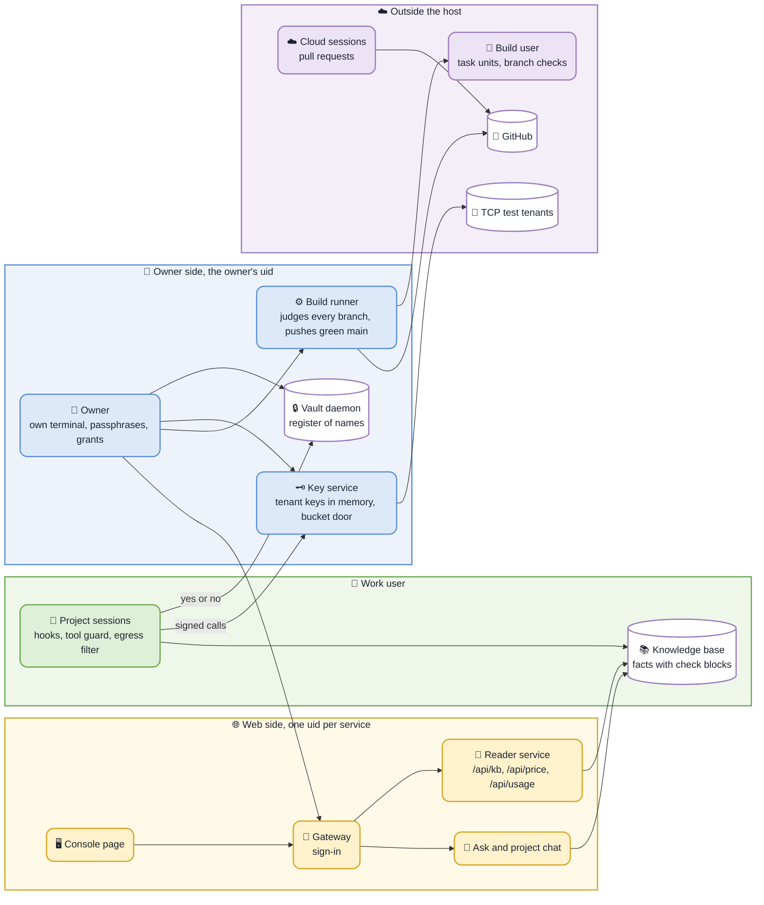

# The design in detail

The parts of the Workbench, where they live in this repository and what is personal to its author. Back to the [README](../README.md).

## The parts

Two users on one host hold the two sides apart. The owner keeps the register of names (the vault), the tenant
keys (the key service) and the originals. The work user runs every session and owns the projects. A session gets a
yes or no from the vault and a signed call from the key service, never a name and never a key.

| part | what it is |
|---|---|
| the vault daemon | the register of codes and names, encrypted at rest; a session asks it whether a text carries a name and gets a yes or no |
| the key service | holds the keys and secrets of the test tenants in memory and signs the calls a session sends; since week 42 it is also the owner's one door to the bucket (`awb bucket`, `awb import`, `awb fetch`, `awb dataset put`), so no bucket key lives in the environment |
| the project sessions | Claude Code as the work user, one folder per project, seven hooks, a tool guard, an egress filter that refuses every host outside the list |
| the knowledge base | checked facts with a grade and an expiry; the fact-check service checks an expired fact again on a test tenant (a check block per fact, a weekly read run, a monthly write run, a watchdog) |
| the console | the web side behind a sign-in: the projects, the board, the tenants, the project chat and Ask; its page reads the knowledge base, the price lookup and the usage from the reader service (`/api/kb`, `/api/price`, `/api/usage`); the old read-only portal is gone |
| the build runner and `awb pr take` | the Workbench builds itself: a task runs as the build user in sandboxed units, a pull request of a cloud session is checked in the same sandbox and taken in with one command, `sudo awb deploy` brings a release live |

## Layout

| folder | what |
|---|---|
| `awb/` | the package and the `awb` command; `awb/tcp/` holds what belongs to TCP |
| `rules/` | one rule per file with its reason and what enforces it, plus the data files of the checks |
| `hooks/` | git hooks: `pre-commit` and `commit-msg` run no content check (a commit here is checked at its push), `pre-push` runs the exit check (`git config core.hooksPath hooks` installs them) |
| `hooks-build/` | the commit gate of the build clones: no content check, only the size limit and the co-author line; the push of `main` has the exit check |
| `seal/` | setup and verification of the two-user seal, the service units, the work user's client settings |
| `plugin/` | the Claude Code plugin: skills, workers and hooks, its manifest in `plugin/.claude-plugin/plugin.json` |
| `.claude-plugin/` | `marketplace.json` makes this repository the marketplace of the plugin |
| `workflows/` | the review and refresh workflows for Claude Code |
| `recipes/` | the lab recipes of `awb lab`, one live check on a test tenant per file; the format in `recipes/README.md` |
| `calibration/` | the review calibration set, the red-team pack and the records of the red team and the security review |
| `tests/` | every test, invented names only |
| `build/` | `tests.json`, every test with its status; the queue of the build runner lies in `build/queue/` and stays out of git |
| `docs/api/` | the contract of the web API (`awb api check`) |
| `CLAUDE.md` | the rules for a Claude Code session in this repository |
| `COMMANDS.md` | every `awb` command by who runs it; generated, do not edit (see below) |
| `docs/commands-guide.md` | the hand-written text of `COMMANDS.md` |
| `tools/` | `gen_docs.py`, the generator of `COMMANDS.md` and the three client hook files |
| `INTERFACES.md` | the interface of every module |
| `CHANGELOG.md` | what changed, one entry per week |

## Personal parts

- `rules/voice.txt`, the drafting skill and `tests/test_his_voice.py` carry the author's own writing style, measured
  from his own typed English. Replace them with yours.
- The knowledge base of TCP facts is not part of this repository. `awb kb` works on an empty one.
